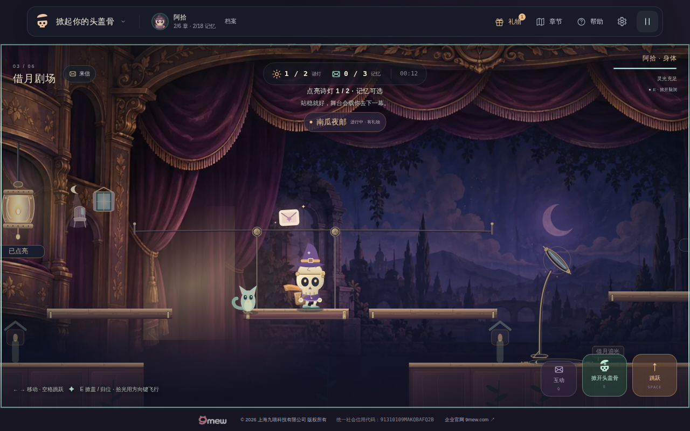
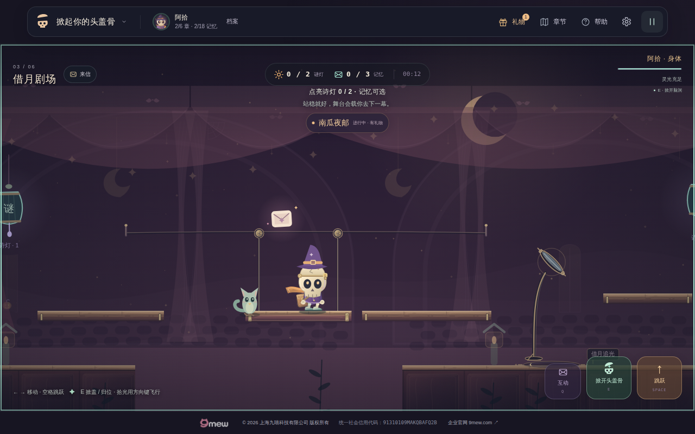
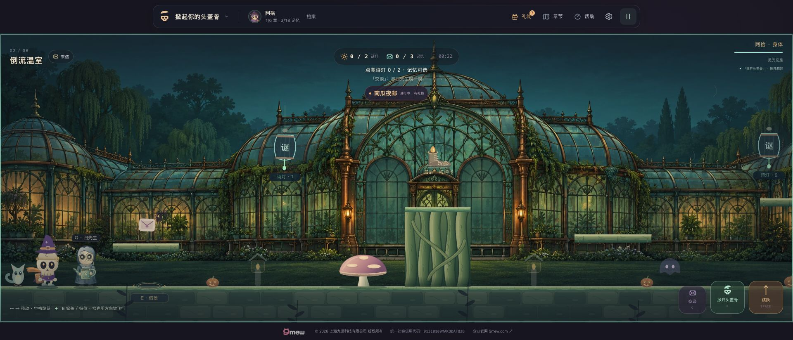

# 掀起你的头盖骨 · 给明天的一封信

原创 2D 横向叙事机关冒险。阿拾负责站稳、跳跃与压住机关；掀开头盖骨，让小光灵拾光飞出，穿过薄幕、收集记忆并解开诗灯。

- 游戏：[掀起你的头盖骨](https://zhangshuaibo1.github.io/tougaigu/)
- 当前公开版本：**22.0.0「借月剧场·绒光与拾光」**，源码、Pages 及公网 Chromium 浏览器验收已完成，详见 [QA-v22](docs/QA-v22.md)。
- 原生 JavaScript / Canvas，无运行时第三方 JavaScript 依赖；原《再活一局》保留在 `survivor.html`。
- 六章、十个节日、原有存档与奖励规则保留。企业页脚与原地址不变。

## 借月剧场·绒光与拾光（v22）

第三章主后景使用原创精绘：绒幕褶皱、旧铜雕花、木质包厢与远景月色。2172×724 WebP 仅178,844字节，按原始比例随镜头绘制，真实地面、舞台、两岸、绳索、诗灯与月镜仍是运行时对象。前两章不请求剧场图片；加载失败依次回退原SVG与程序布景。

拾光在故事前三章有更圆润的珍珠体积、柔和反光与真实速度驱动的尾部弯曲；低能量困倦、回归微笑、抱票和抱种子保留原互动语义，真实掀盖/回盖姿态与前缘遮挡不变。谢幕开始后切为拾光也会按时结束，暂停与减动规则保持。



上图为成功公网验收 40825313256 的 1280×800 Chromium 实际游戏画面。[双灯与拾光](docs/v22-live-two-lamps.png) · [320px 模拟触摸实景](docs/v22-live-320.png) · [完整公网原始报告](docs/verification-v22-public-full.json)。手机顶部提示仍需整理，下一轮按 [v23 计划](docs/PLAN-v23.md) 接续。

[完整验收与边界](docs/QA-v22.md) · [原创美术与提示](docs/art/theatre-painted-v22-prompt.md) · [离线合成记录](docs/verification-v22-offline.json)

## 借月剧场·双灯谢幕（v21）

从左岸真正乘上移动台、被平台带过断口并在右岸实际落脚后，角色身边呈现一枚轻巧的原创月牙与紫绒缎带「谢幕」，持续约2.1秒。动画取自真实物理承载与落脚状态，死亡、灵魂飞越或直接出现右岸不会误触发。每次重开章节至多一次；暂停冻结，减少动态使用静止效果，不增加弹窗、奖励、存档键或输入锁。

真正在第三章解开两盏主线诗灯（「低头思故乡」与「月亮」），第一盏仅左区渐亮、第二盏增加右区；暂停期间灯光不推进，重新开局两区归零。候选浏览器以1280键盘、390和320 Chromium模拟触摸完成真实首台跨越，并检验单次谢幕，区别于整章或物理手机验证。见 [QA-v21](docs/QA-v21.md)。

## 借月剧场·绒幕与月光（v20）

第三章新增原创绒幕、黄铜台口、木质包厢与安静观众席，保留世界空间中的真实移动台、吊索与人物。两盏主线诗灯新增玻璃厚度、黄铜笼架和真实灯芯，点亮会渐亮各自背景光区，暂停冻结；仅第三章按需加载美术，异常时回退旧可玩布景。已确认公网 Chromium 正常键盘过台、390模拟触摸过台、拾光解开第二盏实际谜灯并观察右侧背景光。详细证据与未覆盖边界见 [QA-v20](docs/QA-v20.md)。

## 本轮可玩变化

### 借月剧场 · 稳稳登台

第三章的移动舞台、两岸踏台与地面前缘使用统一暖木材、紫褐裙板和黄铜连接件。吊索滑轮跟随实际台位转动；台面顶边和左右宽度严格贴合原有碰撞，舞台与岸边真正接合时，实际重叠的一段顶边才亮起来。

阿拾在第三章复用已精修的邮差步态、衣料、背包与骨质细节，增加紫色月光反射。阴影投到脚下最近的真实可站立表面，随高度变淡、收拢，并裁在平台内；坑洞下没有承载面时不画悬空地面阴影。

左岸等台、舞台靠近、随台渡过、右岸下台使用原有提示位置显示简短反馈。提示由真实身体与平台位置决定，不覆盖朋友交谈、诗灯或借月追光。关卡几何、平台周期、移动承载、存档和奖励规则保持原样。

完整验证记录：[QA-v19](docs/QA-v19.md)。这一轮后继续提升剧场背景与角色、前景之间的完成度。



上图来自原公开地址的1280×800 Chromium实际游玩，390px触摸截图及范围见[QA-v19](docs/QA-v19.md)。

### 倒流温室 · 玻璃与新芽

v17 将第一章的绘本景深推广到第二章：铜框玻璃、藤蔓、树影、安静前院与细化的石砖、苔藓木台、盘根高台和弹床蘑菇形成完整场景。两扇拱窗分别响应本回合对应诗灯，不因旧收藏提前发亮。生产全景为 2172×724 WebP、508,666 字节，按第二章按需加载；失败使用原可玩温室。

去程票折成的纸盆、种子拾取和归位、嫩芽到小花的成长继续使用真实游戏事件。蘑菇压缩回弹来自实际弹床状态，平台表现与原碰撞尺寸一致。原稿、提示和校验值见 [温室素材说明](docs/ART-DIRECTION-v17.md)。

### 头顶的小信窗

第二章结尾既有的“让风把它送出去／先替她好好保管”现在留下可见回响：

- **寄出**：重访温室时看到开窗、风线与纸鸟印记；第一次掀盖，信封沿弧线随风飞出。
- **保管**：窗格、小阅读灯以及头内带蜡封的信保持可见；掀盖时信件回到头内靠窗位置。
- 回响在原脑洞投影后播放2.8秒；同回合重复掀盖不重复演出。旅途日记的“重新回信”会立即同步新分支。
- 暂停冻结演出，减动保留静态选择结果；恢复动效不补播。信窗不新增存档键、奖励、碰撞或种子/花。

归先生在温室里增加骨质明暗、银发层次、斗篷折面和缝线、黄铜单片镜与绿釉铜边洒水壶。双手握点随壶体旋转，既有视线、眨眼和抬壶动作继续驱动角色。



上图为原公开地址的 Chrome 实际画面，含现有万圣节装扮和网页界面。窄屏截图、测试范围与限制见 [QA-v18](docs/QA-v18.md)。

## 怎样看到信件回响

正常完成第一、二章，在第二章结果页“拆开这一站的来信”，读完后选择寄出或保管。通过章节地图重访倒流温室，按 E 掀盖，保持约4秒。顶部档案里的“故事选择 → 重新回信”可改选；返回温室再次掀盖即可查看新分支。没有作过该选择的存档不会凭空出现信窗。

## 操作

身体用 A/D 或左右方向键移动，W/上/空格跳跃。E 掀盖或归位；拾光用方向键自由飞行，靠近诗灯后按 Q/空格解谜。身体靠近朋友按 Q 交谈；Escape 暂停。手机使用方向和动作按钮。

记忆为可选探索，主线需要点亮本章全部诗灯，再让身体走进出口。借景小戏、失物招领与第三章借月追光均保留。

## 发布与实际验证

v19源码：[45cfb080](https://github.com/zhangshuaibo1/tougaigu/commit/45cfb080f868f071e9d4be8b8086458ca7e0924f)。Pages：[e21aca04](https://github.com/zhangshuaibo1/tougaigu/commit/e21aca04b379a4485eae5a3d8449d32bd4503471)。118个运行时blob与源码dist完全一致，只另加`.nojekyll`。

- **504项 / 44个测试文件通过**；50个JS模块、135个本地引用、176个版本引用通过；66项离线生产Canvas检查通过。
- [候选40816162223](https://github.com/zhangshuaibo1/tougaigu/actions/runs/40816162223)、[Pages40816584342](https://github.com/zhangshuaibo1/tougaigu/actions/runs/40816584342)、[main/公网40816586535](https://github.com/zhangshuaibo1/tougaigu/actions/runs/40816586535)均成功。
- 保留前两章与信件完整浏览器验收；新增正常解锁第三章后的键盘过台，再在同一存档正常重启并以390px模拟触摸过台。实际验证等台、登台、无输入承载、真实右岸接合与下台，零跌落、无相对平台滑移、无误解灯或误结算。
- main验收的候选与公网各三个视口均19.0.0，零页面/HTTP错误。320/390独立触屏case仍覆盖第一章收票、暂停与布局；新增390px第三章范围不是整章或全程手机通关。没有实体手机、Safari或低端GPU性能结论。

完整证据：[QA-v19](docs/QA-v19.md) · [公开浏览器完整报告](docs/verification-v19-public.json)。

### v18历史验收

v18 运行时代码：[ff385419](https://github.com/zhangshuaibo1/tougaigu/commit/ff385419e5f6a6927c1429c78aec191b2a0c6152)。Pages：[88bdf804](https://github.com/zhangshuaibo1/tougaigu/commit/88bdf804719c1a4d2a32f2c2d71a3b10aadf2677)。部署树与该源码的 `dist/` 一致，只另加 `.nojekyll`。

- **474项 / 40个测试文件通过**；47个JS模块、131个本地引用、167个版本引用检查通过。
- 信窗54项、归先生92项离线生产Canvas检查通过；这些结果不是浏览器或物理手机测试。
- [候选CI40813493108](https://github.com/zhangshuaibo1/tougaigu/actions/runs/40813493108)、[Pages40814084678](https://github.com/zhangshuaibo1/tougaigu/actions/runs/40814084678)、[候选与公网复验40814043011](https://github.com/zhangshuaibo1/tougaigu/actions/runs/40814043011) 均成功。
- 候选与公网各三个视口：1280×800用真实键盘连续完成前两章，并实际完成send/keep选择、地图重访、日记改选、演出暂停/不重播和重载；390×844、320×680用模拟触屏验证第一章收票归位、暂停与无横向溢出。六个case均为18.0.0，零页面及HTTP错误。
- 公开Chrome人工检查包含桌面、390px温室、新归先生与中文界面。窄屏自动测试没有覆盖整章或信窗完整操作；尚无实体手机、Safari或低端GPU性能结论。

完整证据：[QA-v17](docs/QA-v17.md) · [QA-v18](docs/QA-v18.md) · [v18公网完整报告](docs/verification-v18-browser-report.json)。

## 运行与检查

```sh
python3 -m http.server 8080 --directory dist
npm test
npm run check
```

更改package版本后运行 `npm run version:assets`，统一三份入口、样式与模块的缓存版本。浏览器测试工具只用于验收，不是游戏依赖：

```sh
python -m pip install playwright==1.55.0
python -m playwright install chromium
python scripts/browser-smoke.py --url http://127.0.0.1:8080/ --version 20.0.0 --output verification/browser
```

浏览器脚本在测试请求中追加只读坐标/状态查询。移动、跳跃、答题、剧情选择均使用正常键盘、触控与DOM按钮，不注入坐标、存档、完成状态或奖励。生产模块不包含测试查询接口。

## 源码、存档与持续迭代

`main`保存源码、测试和文档；`gh-pages`根目录部署`dist/`内容并保留`.nojekyll`。更新分支前读取精确SHA并使用并发保护；发现其他会话已发布同一候选，继续其验证流程。

原v14物理保留于`dream-engine-base.js`，前三章表现由`dream-engine.js`薄子类接入。信件演出在`dream-letter-echo.js`，NPC绘制在`dream-encounter-art.js`，第三章平台、提示和投影在`dream-theatre-art.js`、`dream-theatre-guidance.js`、`dream-ground-shadow.js`；全部使用原有更新循环。

存档仍在当前浏览器本地保存，可由顶部设置导出旅途备份；不是账号云同步。v17–v19不清空或迁移旧存档，不新增奖励结算。

当前v21进度及发布依据详见 [QA-v21](docs/QA-v21.md)。下一轮建议 **v22「借月剧场·演员与月影」**：继续细化阿拾/拾光月光下的表情与动效，解决320px场景上方HUD信息拥挤，保证诗灯与月镜优先级；先读最新 [迭代交接](docs/ITERATION.md) 和远端分支/CI，勿重复发布。

[完整v2–v14历史](docs/README-v14.md) · [v16验收](docs/QA-v16.md) · [素材来源](docs/CREDITS.md)

© 2026 上海九喵科技有限公司。统一社会信用代码：91310109MAKQBAFQ2B。仓库公开展示，不另行授予开源许可。
