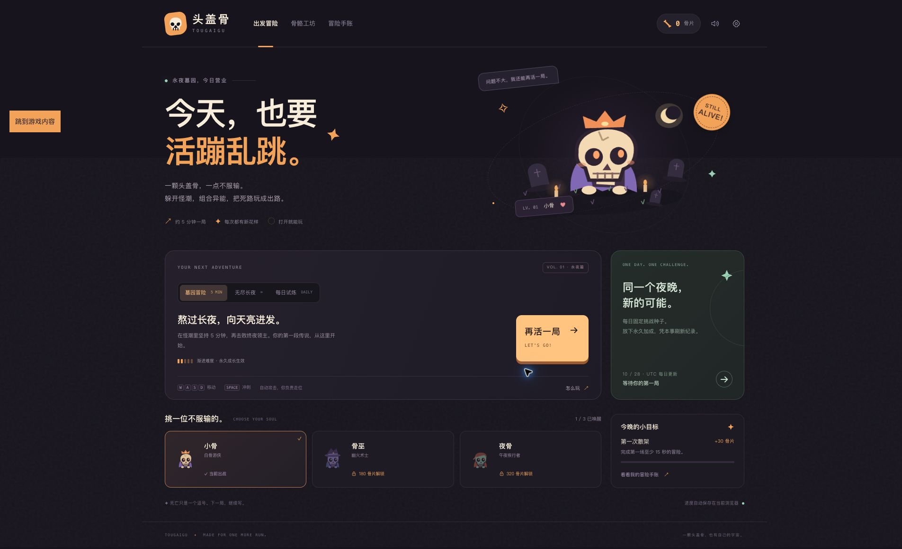
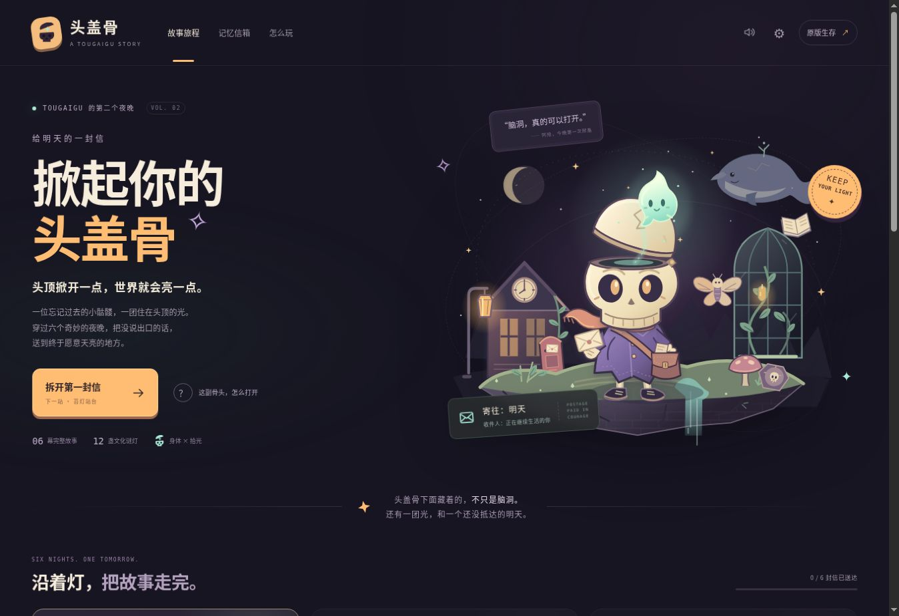
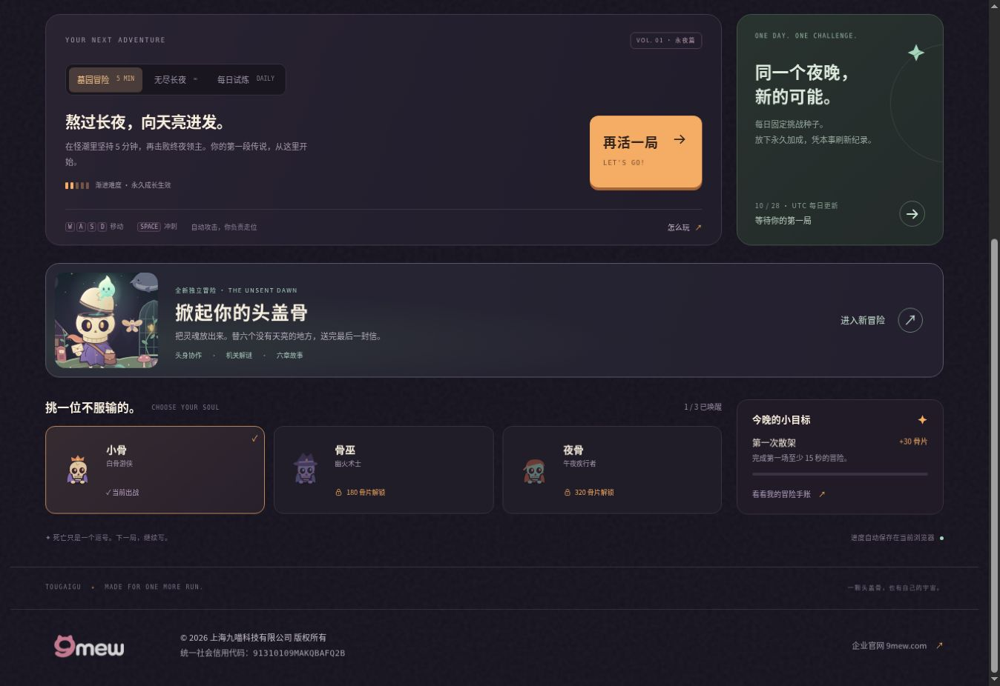

# 头盖骨 · 双重冒险

**TOUGAIGU** 是一个中文、原创视觉、零运行时依赖的双游戏项目。保留《再活一局》的生存玩法，新增独立的故事机关冒险《掀起你的头盖骨》。

> 一颗头盖骨，一点不服输。躲开怪潮，组合异能，把死路玩成出路。

- 《再活一局》：<https://zhangshuaibo1.github.io/tougaigu/>
- 《掀起你的头盖骨》：<https://zhangshuaibo1.github.io/tougaigu/dream.html>
- 仓库：<https://github.com/zhangshuaibo1/tougaigu>
- 当前版本：2.0.0
- 仓库已公开；自定义域名 `tougaigu.com` 尚未绑定。



## 新游戏：掀起你的头盖骨



阿拾是失去记忆的小骷髅邮差。他收到一封地址只有“明天”的信，带着住在头盖骨里的小光灵“拾光”，穿过六处迟迟不肯天亮的地方。每个地方都有一位等待的人、一道不愿松开的心结，以及一件可以带走的信物。

这是横向卷轴的机关与叙事冒险。身体负责行走、跳跃和压住机关；掀开头盖骨后，灵魂可以自由飞行、越过记忆薄幕并唤醒谜灯。点亮两盏谜灯后，身体才能通过章节出口。谜灯实际连接诗词、灯谜、歇后语和道具推理，答对或主动借助完整提示后才会点亮。

### 六章行程

| 章节 | 场景与机关 |
| --- | --- |
| 苔灯站台 | 旧车站、风铃和苔灯；身体压住地板机关，灵魂穿过薄幕 |
| 倒流温室 | 玻璃花房、发光藤蔓与弹跳蘑菇 |
| 借月剧场 | 幕布、灯光与移动舞台 |
| 鲸落图书馆 | 漂浮书页、沉睡巨鲸与灵魂风场 |
| 钟摆海岸 | 海风、钟塔与可被灵魂脉冲短暂停住的钟摆 |
| 黎明邮局 | 汇合前面学到的机关，把最后一封信交给明天 |

每章有三片可选记忆、两盏谜灯、开场与收尾对白。故事中有两次重要选择，通向不同尾声；可以重玩章节、收集遗漏记忆、提高星级和补齐信物。谜题有逐步提示和答案解释，答错可重试。

### 新冒险操作

- 身体：A / D 或左右方向键移动；W / 空格跳跃。
- 灵魂：E 掀盖放出灵魂，再按 E 回到身体；WASD / 方向键自由飞行。
- 灯与机关：灵魂靠近谜灯后按空格或 Q 发出脉冲。
- 暂停：Escape；手机使用页面提供的触屏控制。
- 进度独立存放在 `tougaigu.dream.v1`，不会覆盖原游戏的角色、骨片或成绩。
- 偏好设置支持导出、导入故事存档；正在游玩的章节位置不会跨刷新保存。

通关获得一星；同一局收齐本章三片记忆获得两星；再满足零跌落与本章目标时间则获得三星。两次回信也可以在记忆信箱中重新选择，发现不同结局。

详细故事、谜题和存档逻辑见 `dist/dream-story.js`；物理机关与六章地图分别见 `dist/dream-engine.js`、`dist/dream-levels.js`。

54 项测试及桌面、手机响应式试玩记录见 [v2 验收记录](docs/QA-v2.md)。

## 原游戏：再活一局

玩家控制一只小骷髅，在不断涌来的怪物中生存。攻击自动瞄准，玩家专注走位、收集经验、冲刺避险与选择升级。

一局的循环是：**走位 → 击败怪物 → 收集经验 → 三选一升级 → 组合流派 → 击败首领 → 结算骨片 → 永久强化 / 解锁角色 → 再来一局**。

### 三种模式

| 模式 | 目标 | 永久强化 | 角色 |
| --- | --- | --- | --- |
| 墓园冒险 | 生存至 300 秒并击败第三位首领 | 生效 | 已解锁角色任选 |
| 无尽长夜 | 持续增长的难度，挑战个人最好成绩 | 生效 | 已解锁角色任选 |
| 每日试炼 | 相同 UTC 日期对应固定种子，刷新当日个人纪录 | 不生效 | 固定为小骨 |

首领在 90、180、300 秒出现，标准模式需要实际击败终夜首领才算通关。因此常规一局约为五分钟或稍长。每日种子固定的是随机序列，不会替玩家做出相同的选择；移动、升级策略与操作仍然改变结果。

### 角色与成长

- **小骨 / 白骨游侠**：初始免费，110 生命，均衡的生存与火力。
- **骨巫 / 幽火术士**：180 骨片唤醒，85 生命，自带一级灵魂环绕。
- **夜骨 / 午夜疾行者**：320 骨片唤醒，90 生命，移动更快、暴击更高、冲刺冷却更短。
- 18 项局内升级、3 个组合进化、5 项永久强化、8 项一次性成就奖励。
- 常规敌人包括幽灵、蝙蝠、软糖、远程法师、冲锋怪；首领有独立攻击模式。

| 进化 | 条件 |
| --- | --- |
| 灵魂星环 | 灵魂环绕 4 级 + 脚底抹油 3 级 |
| 雷霆共鸣 | 天打雷劈 4 级 + 手速超度 3 级 |
| 白骨风暴 | 硬骨头 5 级 + 一骨三连 3 级 |

永久强化每级分别增加 4% 初始伤害、8 点初始生命、3% 攻速、10 点拾取半径或 2% 经验。每项最多五级，购买成本随等级增长。

## 操作

| 平台 | 移动 | 冲刺 | 其他 |
| --- | --- | --- | --- |
| 电脑 | WASD / 方向键 | 空格 | Escape 暂停；升级时 1 / 2 / 3 选择 |
| 手机 / 窄屏 | 左下虚拟摇杆 | 右下冲刺按钮 | 点击升级卡；左上暂停按钮 |

切换标签页或窗口失焦会暂停战斗。升级选择期间时间暂停。设置中可以关闭合成音效、减少动态效果、导出和导入存档。


## 存档与数据边界

- 成长进度使用当前浏览器的 `localStorage`，键为 `tougaigu.save.v1`。
- 钱包、角色、永久强化、成就、最近 20 局战绩及最近 30 天的每日最好成绩会保存。
- 坚持至少 15 秒才结算成长奖励；成就奖励只领取一次；同一局有唯一 ID 防止重复结算。
- 退出战斗会结算这一局。当前正在进行的战斗不提供跨刷新续局，刷新后开始新的一局。
- 导出 JSON 可以备份和跨设备迁移；导入校验版本、结构、字段与数值，并要求确认替换当前进度。
- 首发版没有账号系统、云存档、在线多人或全球排行榜。手账显示当前浏览器的真实战绩。
- 所有分数与奖励由客户端计算，适合单人娱乐；不能把本地记录当作防作弊竞技成绩。
- 不依赖付费模型 API、第三方图片/字体、分析埋点、广告或支付。

## 本地运行

无需安装 npm 依赖。使用任何能提供静态文件的 HTTP 服务：

```bash
git clone https://github.com/zhangshuaibo1/tougaigu.git
cd tougaigu
python3 -m http.server 8080 --directory dist
```

然后访问 `http://localhost:8080`。浏览器 ES modules 需要 HTTP 服务，不要直接双击 HTML 文件。

需要 Node.js 运行静态检查与测试：

```bash
npm run check
npm test
```

也可以逐个运行测试文件查看各场景：

```bash
node tests/engine.test.mjs
node tests/progression.test.mjs
node tests/dream-engine.test.mjs
node tests/dream-story.test.mjs
```

## 项目结构

```text
dist/
  index.html     页面、游戏 HUD、原生对话框
  style.css      响应式视觉、战斗界面、窄屏摇杆
  app.js         页面交互、输入、结算与存档整合
  engine.js      Canvas 渲染、战斗、技能、首领、音效
  content.js     中文内容、角色、成长、存档校验
  favicon.svg   原创矢量图标
  dream.html    新冒险首页、章节、手账与对话界面
  dream.css     新冒险响应式视觉
  dream-app.js  新冒险交互、谜题与进度整合
  dream-story.js 六章故事、谜题与独立存档
  dream-engine.js 头身协作、物理机关、动画与场景绘制
  dream-levels.js 六章地图与场景配置
  company-footer.css 企业版权共用样式
  portal.css    原游戏中的新冒险入口
  assets/       本地企业 Logo、原创 SVG 封面与人物插画
tests/
  engine.test.mjs
  progression.test.mjs
  dream-engine.test.mjs
  dream-story.test.mjs
scripts/
  check.mjs     JavaScript 语法与本地资源引用检查
docs/
  QA.md
  QA-v2.md      双游戏、谜题、存档与发布验收
  homepage.jpg
  dream-homepage.jpg
  dream-puzzle.jpg
  dream-mobile.jpg
  upgrade.jpg
  mobile.jpg
  CREDITS.md    素材与诗文出处
.openai/hosting.json
```

## 部署与域名

部署产物就是 `dist/`，无构建步骤。当前通过 GitHub Pages 托管，地址为 <https://zhangshuaibo1.github.io/tougaigu/>，已启用强制 HTTPS。

发布配置为 Settings → Pages → Deploy from a branch → `gh-pages` → `/ (root)`。`gh-pages` 分支根目录放置 `dist/` 的内容及 `.nojekyll`，游戏源文件、测试与文档保留在 `main` 分支。更新游戏后，需要将新的 `dist/` 内容同步到发布分支。

- v2 游戏源码：[5f110b3](https://github.com/zhangshuaibo1/tougaigu/commit/5f110b314ed76a6e42e16e650ca670dd38a2b151)。
- v2 Pages 提交：[0146d89](https://github.com/zhangshuaibo1/tougaigu/commit/0146d893daed492b3b9e8682be97c2a834f2acab)。
- v2 发布工作流：[pages build and deployment](https://github.com/zhangshuaibo1/tougaigu/actions/runs/40700304082)，结果成功。两款游戏均已打开公网地址复核。

HTML 的样式、脚本与图标路径，以及 JavaScript 模块导入均使用相对路径，已在 GitHub Pages 的 `/tougaigu/` 子路径下实际运行。

`tougaigu.com` 尚未绑定。购买并确认域名所有权后，可在 GitHub Pages 中设置自定义域名，并依据 GitHub 给出的要求配置 DNS；本项目没有替用户购买域名或修改 DNS。

## 企业版权与素材

网页底部展示 **© 2026 上海九喵科技有限公司 版权所有**，统一社会信用代码 **91310109MAKQBAFQ2B**，企业官网为 <https://9mew.com>。官方 Logo 已下载到项目中，由本站直接加载。



古典诗文原句、通行歇后语与原创谜面分别注明；诗文校对及 Logo 原始地址见 [素材与文本来源](docs/CREDITS.md)。仓库公开展示源码，暂未额外授予开源许可。
