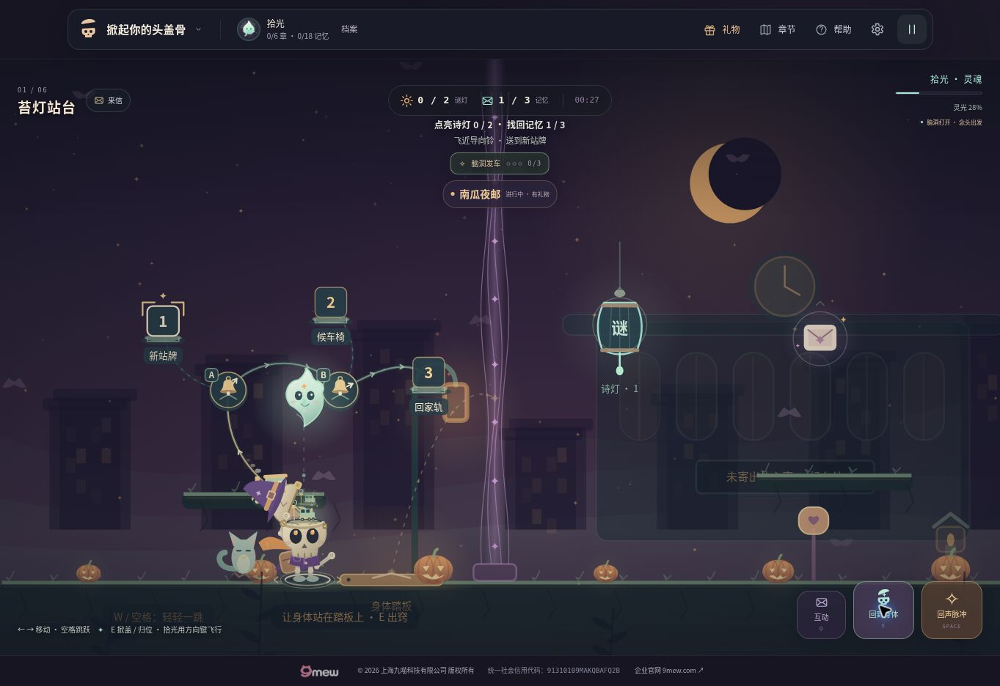
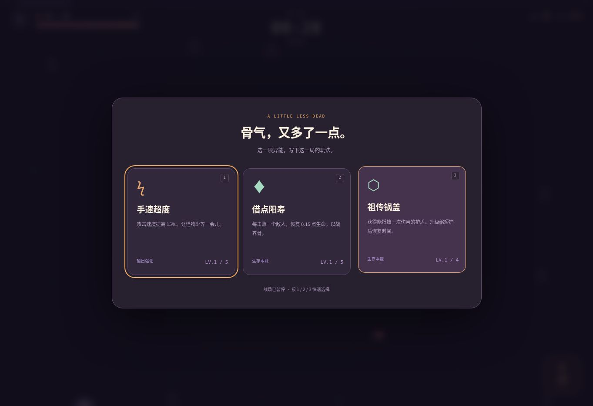

# 头盖骨 · 双重冒险

**TOUGAIGU** 是一个中文、原创视觉、零运行时依赖的双游戏项目。保留《再活一局》的生存玩法，新增独立的故事机关冒险《掀起你的头盖骨》。

打开网站直接进入《掀起你的头盖骨》的关卡。顶部悬浮菜单用于切换游戏、领取时光礼物、进入节日故事、打开章节或备战、查看角色档案、帮助和设置。

- 默认入口《掀起你的头盖骨》：<https://zhangshuaibo1.github.io/tougaigu/>
- 《再活一局》：<https://zhangshuaibo1.github.io/tougaigu/survivor.html>
- 新冒险旧链接仍可使用：<https://zhangshuaibo1.github.io/tougaigu/dream.html>
- 仓库：<https://github.com/zhangshuaibo1/tougaigu>
- 当前版本：6.0.0
- 仓库已公开；自定义域名 `tougaigu.com` 尚未绑定。



## 新游戏：掀起你的头盖骨

阿拾是失去记忆的小骷髅邮差。他收到一封地址只有“明天”的信，带着住在头盖骨里的小光灵“拾光”，穿过六处迟迟不肯天亮的地方。每个地方都有一位等待的人、一道不愿松开的心结，以及一件可以带走的信物。

这是横向卷轴的机关与叙事冒险。身体负责行走、跳跃和压住机关；掀开头盖骨后，灵魂可以自由飞行、越过记忆薄幕并唤醒谜灯。点亮两盏谜灯后，身体才能通过章节出口。谜灯实际连接诗词、灯谜、歇后语和道具推理，答对或主动借助完整提示后才会点亮。

### 六章行程

| 章节 | 场景与机关 |
| --- | --- |
| 苔灯站台 | 旧车站、风铃和苔灯；身体压住地板机关，灵魂穿过薄幕 |
| 倒流温室 | 玻璃花房、发光藤蔓与弹跳蘑菇 |
| 借月剧场 | 幕布、灯光与移动舞台 |
| 鲸落图书馆 | 漂浮书页、沉睡巨鲸与灵魂风场 |
| 钟摆海岸 | 海风、钟塔与可被灵魂脉冲短暂停住的钟摆 |
| 黎明邮局 | 汇合前面学到的机关，把最后一封信交给明天 |

每章有三片可选记忆、两盏谜灯、开场与收尾对白。故事中有两次重要选择，通向不同尾声；可以重玩章节、收集遗漏记忆、提高星级和补齐信物。谜题有逐步提示和答案解释，答错可重试。

### 新冒险操作

- 身体：A / D 或左右方向键移动；W / 空格跳跃。
- 灵魂：E 掀盖放出灵魂，再按 E 回到身体；WASD / 方向键自由飞行。
- 灯与机关：灵魂靠近谜灯后按空格或 Q 发出脉冲。
- 暂停：Escape；手机使用页面提供的触屏控制。
- 进度独立存放在 `tougaigu.dream.v1`，不会覆盖原游戏的角色、骨片或成绩。
- 设置支持导出、导入旅途存档（主线、脑洞画册、借景路线、节日收藏、装扮、两款游戏共享时光奖励），并兼容原版故事存档；正在游玩的章节位置不会跨刷新保存，借景已送达的目标可以续玩。

通关获得一星；同一局收齐本章三片记忆获得两星；再满足零跌落与本章目标时间则获得三星。两次回信也可以在记忆信箱中重新选择，发现不同结局。

详细故事、谜题和存档逻辑见 `dist/dream-story.js`；物理机关与六章地图分别见 `dist/dream-engine.js`、`dist/dream-levels.js`。

原有玩法的 54 项测试及桌面、手机响应式试玩记录见 [v2 验收记录](docs/QA-v2.md)。直接进入游戏与悬浮菜单的更新验收见 [v2.1 验收记录](docs/QA-v2.1.md)。节日、奖励和新版部署的121项回归及浏览器验收见 [v3 验收记录](docs/QA-v3.md)。

## v6：扶住盖沿，让小景长出来

阿拾的头盖、抓点与手臂现在使用同一套角色姿态。转身、行走、落地或快速掀盖时，手指仍然扶着真实盖沿；拾光探头与归位从骨缘后穿过，露出的部分和藏进头里的部分有明确前后关系。拾光的火苗尖顶与额星、阿拾邮包上的金色星扣，也与角色立绘保持一致。

每次借景送达，一件新景物用不到半秒的短动作展开；已有景物保持安稳。最后一件完成后，小戏核心随之显现。暂停会冻结展开，读取旧成果直接呈现完整小景，减少动态模式也直接显示落成结果。

手机借景增加专门构图：320和390像素宽都能同时看见三处目的地与名称，不会在操作一个岔路时丢掉另一端。归位后回到正常镜头，主线移动和碰撞不变；画面删去重复操作句，仅保留顶部提示和铃旁的Q标记。

211项回归场景、双向角色姿态及实际手机续玩验证见 [v6 验收记录](docs/QA-v6.md)。

## v5：把脑袋里的小世界借出来

六章和十个节日场景都增加了一出可选的**借景小戏**。阿拾站在起点附近的发光圆环供光，掀盖放出脑内的小主角；拾光飞到两只导向铃旁，按空格或 Q 改变岔路，把它送往当前亮起的目的地。三个目的地送齐，新的小景就在阿拾身边搭好。

温室里是嫩芽、花盆、叶台阶与迎风窗，车站里是小火车、站牌和回家轨；万圣节的小灯搭起邀请客人的南瓜夜市，感恩节的暖汤勺替厨师添一个座位，情人节的半心邮戳把倾听亭和回信台接起来。共16位小主角、48处目的地与112句短反馈，每次操作都围绕“把头盖骨里的想法带到外面”。

| 玩法 | 行为 |
| --- | --- |
| 借景 | 身体站稳在发光圆环，E 掀盖；灵魂靠近高亮导向铃，用空格或 Q 转向 |
| 送错路线 | 小主角回到起点再试，不扣除物品或已完成的目标 |
| 中途归位 | E 回来补充灵光，当前小主角的位置与路线暂时停住；再掀盖继续 |
| 重玩 | 三站送齐后归位，在圆环按 Q 选择下一条未完成路线；共三种固定送达顺序 |
| 收藏 | 脑洞画册记录16出小戏、48条路线和完整尝试的最好转向次数/时间 |
| 刷新续玩 | 保存当前路线及已经送达的目标；角色从章节起点开始，小主角从路线起点接着送剩余目标 |

恢复部分进度的尝试会解锁收藏，但不会把最后几秒虚构成完整速度纪录。借景进度独立存放于 `tougaigu.capactivities.v1`，加入旅途备份；缺少这个字段的旧备份保留现有借景记录。普通跨标签贡献会合并，导入替换有独立修订，已完成尝试的迟到事件不会重新建立待续路线。

主线谜灯、机关、出口与原有奖励条件保持独立。借景游玩沿用现有的有效游玩时长规则，不重复发放额外道具。画面只在靠近圆环或进行小戏时显示简短进度；手机继续使用原有方向、掀盖、互动和脉冲按钮。

实现见 `dream-cap-activities.js`、`dream-cap-activity-engine.js`、`dream-cap-activity-art.js` 与 `cap-activity-progress.js`。200项回归场景与实际桌面、触屏、刷新续玩、导出验证见 [v5 验收记录](docs/QA-v5.md)。

## v4：打开脑袋里的小宇宙

“掀起头盖骨”现在既是操作，也是贯穿六幕的叙事线索。阿拾按下黄铜搭扣，帽子和头盖沿铰链抬起，拾光从脑内探出来；归位时沿弧线回家，再轻轻扣盖。控制权立即切换，演出不会锁住移动。身体会看向拾光、扶住盖子，拾光会因收集、鼓起勇气和低能量改变表情。

| 主线 | 头盖骨里的小剧场 |
| --- | --- |
| 苔灯站台 | 头顶的候车室：没说出口的“你好”搭上脑洞专线 |
| 倒流温室 | 一颗念头发了芽：旧车票成为小花盆 |
| 借月剧场 | 纸月亮首演夜：阿拾主演，拾光兼任追光 |
| 鲸落图书馆 | 一片有鲸的留白：小鲸只吃留白，不吃错别字 |
| 钟摆海岸 | 怀表的一小步：给停住的一秒开一扇窗 |
| 黎明邮局 | 住在头顶的日出：头盖骨不再锁住明天 |

十个节日也各有脑内微景和短对白，包括南瓜夜市、暖汤长桌、雪铃失物所、零点烟花铺、年兽试鼓、兔灯小窗、半心邮戳、龙舟、鹊桥、月饼地图。共16个微景、144句与掀盖、归位、收集和点灯事件关联的短对白。场内对白不暂停游戏；完整来信仍由玩家主动打开。

角色档案新增**脑洞画册**：保存实际打开的场景、三份念头和两盏谜灯，最多16个脑洞、48个念头、32盏谜灯，可重看脑内舞台和发现的故事。旧章节记录和奖励完整保留；画册从本版本开始记录逐件发现，不凭旧版的汇总数量猜测玩家拿过哪一件。画册使用独立键 `tougaigu.capbook.v1`，随旅途存档一起导出，旧备份缺少画册字段时保留现有画册。

新角色包含阿拾的好奇、扶盖、开心、温柔，以及拾光的探头、开心、勇敢、困倦状态，另有两个默认形象。立绘使用本地SVG，场内角色和脑内舞台使用Canvas；无需下载外部美术。减少动态效果会简化开盖与回家动作、停用展开投影和尾迹，仍可正常解谜。

实现分别见 `dream-cap-art.js`、`dream-cap-story.js`、`cap-progress.js`、`cap-book.js`；角色生成源为 `scripts/build-cap-portraits.mjs`。回归和实际试玩记录见 [v4 验收记录](docs/QA-v4.md)。

## v3：四季来信与时光礼物

节日会按照 `Asia/Shanghai` 日期自动到来。主线保留现有故事和机关，同时出现当季的天气、场景摆设和阿拾服装；顶部“礼物”进入独立节日故事。其余季节故事全年可以回访，活动见面礼和活动时长仅在对应日期累计。活动窗口是游戏设计，不是法定放假安排。

| 节日 | 故事 | 相遇角色 | 活动窗口 |
| --- | --- | --- | --- |
| 万圣节 | 南瓜夜邮 | 南瓜先生 | 10月24日—11月3日 |
| 感恩节 | 空椅子晚餐 | 松鼠厨师栗栗 | 美国感恩节前后3天 |
| 圣诞节 | 雪夜失物所 | 驯鹿学徒铃铛 | 12月18日—27日 |
| 元旦 | 零点修理铺 | 猫头鹰分针叔 | 12月28日—1月4日 |
| 春节 | 年兽的试音会 | 小年 | 农历腊月廿五—正月初八 |
| 元宵节 | 月亮走失了 | 兔子汤圆婆婆 | 农历正月初十—十七 |
| 情人节 | 两封没有地址的信 | 纸鹤阿翎 | 2月10日—17日 |
| 端午节 | 逆风龙舟局 | 浣熊粽队长 | 农历五月初三—初七 |
| 七夕 | 鹊桥维修日 | 喜鹊点点 | 农历七月初五—初十 |
| 中秋节 | 月饼里的地图 | 月兔桂桂 | 农历八月十二—十八 |

每个节日关卡有两盏谜灯、三份任务礼物、可按 Q 对话的角色、开场与途中的对白、结尾回信和两个可选择的收尾。需要点亮两盏灯并收齐礼物，再让身体走到出口。10个节日共增加20道有逐步提示和解释的谜题、30件任务物品、10件永久纪念物及10套节日服装；完成故事即可永久解锁对应衣服，纪念物必须实际通关获得。

场内角色新增眼神与眨眼、步行动作、飘动的围巾和邮包、随头盖翻开的帽子、灵魂尾迹、跟随伙伴的收集反馈。场景有南瓜与蝙蝠、枫叶晚餐、雪夜礼盒、钟楼烟花、红灯笼、河灯、纸心、龙舟、鹊桥与桂树。所有立绘和道具都采用项目内原创 SVG，场内动画采用 Canvas 绘制；减少动态效果可在设置开启。

### 累计游玩奖励

| 奖励轨道 | 累计有效时长 | 礼物 |
| --- | --- | --- |
| 平日第一束光 | 2分钟 | 8星砂、1灵光糖 |
| 平日小旅程 | 5分钟 | 12星砂、1灵光糖、1寻星罗盘 |
| 平日旅途 | 15分钟 | 22星砂、2灵光糖、1轻羽护符 |
| 平日盛装 | 30分钟 | 35星砂、2寻星罗盘、1轻羽护符、晨星披风 |
| 平日收藏 | 60 / 120分钟 | 更丰富的道具、星砂和收藏徽章 |
| 持续旅途补给 | 满120分钟后，每多30分钟 | 每份18星砂、2灵光糖、1寻星罗盘 |
| 节日见面礼 | 活动期间领取，每年每个节日一次 | 10星砂、1灵光糖、1寻星罗盘 |
| 节日阶梯礼物 | 3 / 8 / 20 / 40 / 75分钟 | 逐档增加的星砂和道具；20分钟解锁当季服装，75分钟获得守灯徽章 |

时长来自两款游戏引擎实际推进的时间，跨关卡、跨游戏、跨次游玩累计。暂停、升级选择、故事和谜题弹窗、后台、异常时间跳跃及超过90秒无操作不计时；按住移动键或触屏方向键视为继续操作。普通多标签页通过短期计时租约避免重复累计。节日重叠时，相同的有效游玩可以同时推进两个活动；已达到条件但未领取的往期礼包保留可补领。没有每日连续签到要求，休息不会清零。

- **灵光糖**：灵光未满时补至100%，已满不消耗。
- **寻星罗盘**：在30秒有效游戏时间内指示未收集礼物、谜灯和出口；暂停不倒计时。
- **轻羽护符**：抵消下一次跌落计数，仍按正常规则回到检查点。
- **星砂兑换**：5星砂兑换灵光糖，8星砂兑换寻星罗盘，12星砂兑换轻羽护符。消耗道具用于故事冒险，两款游戏都能赚取奖励。

保存键分别为 `tougaigu.save.v1`（生存成长）、`tougaigu.dream.v1`（主线）、`tougaigu.festivals.v1`（节日故事/衣橱）、`tougaigu.rewards.v1`（共享奖励）、`tougaigu.capbook.v1`（脑洞画册）与 `tougaigu.capactivities.v1`（借景路线）。这些是当前浏览器本地进度，尚无账号云同步；旅途备份包含后五项，生存成长仍由原版设置独立备份。静态本地奖励系统不作为反作弊或兑换真实财物的服务。

日历参考、2025—2035年农历校正与范围外回退说明见 [节日日历来源](docs/FESTIVAL-CALENDAR-SOURCES.md)。新版模块：`dream-festivals.js`、`dream-festival-levels.js`、`dream-festival-art.js`、`play-rewards.js`、`festival-hub.js`；可编辑美术生成源为 `scripts/build-festival-portraits.mjs`。

## 原游戏：再活一局

玩家控制一只小骷髅，在不断涌来的怪物中生存。攻击自动瞄准，玩家专注走位、收集经验、冲刺避险与选择升级。

一局的循环是：**走位 → 击败怪物 → 收集经验 → 三选一升级 → 组合流派 → 击败首领 → 结算骨片 → 永久强化 / 解锁角色 → 再来一局**。

### 三种模式

| 模式 | 目标 | 永久强化 | 角色 |
| --- | --- | --- | --- |
| 墓园冒险 | 生存至 300 秒并击败第三位首领 | 生效 | 已解锁角色任选 |
| 无尽长夜 | 持续增长的难度，挑战个人最好成绩 | 生效 | 已解锁角色任选 |
| 每日试炼 | 相同 UTC 日期对应固定种子，刷新当日个人纪录 | 不生效 | 固定为小骨 |

首领在 90、180、300 秒出现，标准模式需要实际击败终夜首领才算通关。因此常规一局约为五分钟或稍长。每日种子固定的是随机序列，不会替玩家做出相同的选择；移动、升级策略与操作仍然改变结果。

### 角色与成长

- **小骨 / 白骨游侠**：初始免费，110 生命，均衡的生存与火力。
- **骨巫 / 幽火术士**：180 骨片唤醒，85 生命，自带一级灵魂环绕。
- **夜骨 / 午夜疾行者**：320 骨片唤醒，90 生命，移动更快、暴击更高、冲刺冷却更短。
- 18 项局内升级、3 个组合进化、5 项永久强化、8 项一次性成就奖励。
- 常规敌人包括幽灵、蝙蝠、软糖、远程法师、冲锋怪；首领有独立攻击模式。

| 进化 | 条件 |
| --- | --- |
| 灵魂星环 | 灵魂环绕 4 级 + 脚底抹油 3 级 |
| 雷霆共鸣 | 天打雷劈 4 级 + 手速超度 3 级 |
| 白骨风暴 | 硬骨头 5 级 + 一骨三连 3 级 |

永久强化每级分别增加 4% 初始伤害、8 点初始生命、3% 攻速、10 点拾取半径或 2% 经验。每项最多五级，购买成本随等级增长。

## 操作

| 平台 | 移动 | 冲刺 | 其他 |
| --- | --- | --- | --- |
| 电脑 | WASD / 方向键 | 空格 | Escape 暂停；升级时 1 / 2 / 3 选择 |
| 手机 / 窄屏 | 左下虚拟摇杆 | 右下冲刺按钮 | 点击升级卡；左上暂停按钮 |

切换标签页或窗口失焦会暂停战斗。升级选择期间时间暂停。设置中可以关闭合成音效、减少动态效果、导出和导入存档。



## 存档与数据边界

- 成长进度使用当前浏览器的 `localStorage`，键为 `tougaigu.save.v1`。
- 钱包、角色、永久强化、成就、最近 20 局战绩及最近 30 天的每日最好成绩会保存。
- 坚持至少 15 秒才结算成长奖励；成就奖励只领取一次；同一局有唯一 ID 防止重复结算。
- 明确点击结束并结算，或备战中的“结算本局并开始”，才结算当前局。刷新、关闭页面或切换游戏会放弃未结算的战斗，已保存的成长进度保留。
- 导出 JSON 可以备份和跨设备迁移；导入校验版本、结构、字段与数值，并要求确认替换当前进度。
- 首发版没有账号系统、云存档、在线多人或全球排行榜。手账显示当前浏览器的真实战绩。
- 所有分数与奖励由客户端计算，适合单人娱乐；不能把本地记录当作防作弊竞技成绩。
- 不依赖付费模型 API、第三方图片/字体、分析埋点、广告或支付。

## 本地运行

无需安装 npm 依赖。使用任何能提供静态文件的 HTTP 服务：

```bash
git clone https://github.com/zhangshuaibo1/tougaigu.git
cd tougaigu
python3 -m http.server 8080 --directory dist
```

然后访问 `http://localhost:8080`。浏览器 ES modules 需要 HTTP 服务，不要直接双击 HTML 文件。

需要 Node.js 运行静态检查与测试：

```bash
npm run check
npm test
```

也可以逐个运行测试文件查看各场景：

```bash
node tests/engine.test.mjs
node tests/progression.test.mjs
node tests/dream-engine.test.mjs
node tests/dream-story.test.mjs
```

## 项目结构

```text
dist/
  index.html     默认直接进入故事关卡（与 dream.html 同步）
  survivor.html  原版生存游戏与备战面板
  game-shell.js  双游戏切换、角色摘要与悬浮菜单
  game-shell.css 悬浮菜单与紧凑企业页脚
  style.css      响应式视觉、战斗界面、窄屏摇杆
  app.js         页面交互、输入、结算与存档整合
  engine.js      Canvas 渲染、战斗、技能、首领、音效
  content.js     中文内容、角色、成长、存档校验
  favicon.svg   原创矢量图标
  dream.html    故事关卡、章节地图、手账与对话界面
  dream.css     新冒险响应式视觉
  dream-play.css 直接游玩的场景布局
  survivor-play.css 生存场景与备战布局
  dream-app.js  新冒险交互、谜题与进度整合
  dream-story.js 六章故事、谜题与独立存档
  dream-engine.js 头身协作、物理机关、动画与场景绘制
  dream-levels.js 六章地图与场景配置
  company-footer.css 企业版权共用样式
  portal.css    历史推广入口样式（当前页面不再引用）
  assets/       本地企业 Logo、原创 SVG 封面与人物插画
tests/
  engine.test.mjs
  progression.test.mjs
  dream-engine.test.mjs
  dream-story.test.mjs
scripts/
  check.mjs     JavaScript 语法与本地资源引用检查
docs/
  QA.md
  QA-v2.md      双游戏、谜题、存档与发布验收
  QA-v2.1.md    直接游玩、悬浮菜单与手机验收
  game-first-live.jpg
  game-first-mobile.jpg
  homepage.jpg
  dream-homepage.jpg
  dream-puzzle.jpg
  dream-mobile.jpg
  upgrade.jpg
  mobile.jpg
  CREDITS.md    素材与诗文出处
.openai/hosting.json
```

## 部署与域名

部署产物就是 `dist/`，无构建步骤。当前通过 GitHub Pages 托管，地址为 <https://zhangshuaibo1.github.io/tougaigu/>，已启用强制 HTTPS。

发布配置为 Settings → Pages → Deploy from a branch → `gh-pages` → `/ (root)`。`gh-pages` 分支根目录放置 `dist/` 的内容及 `.nojekyll`，游戏源文件、测试与文档保留在 `main` 分支。更新游戏后，需要将新的 `dist/` 内容同步到发布分支。

- v2.1 游戏源码：[1a7c78a](https://github.com/zhangshuaibo1/tougaigu/commit/1a7c78af056f5d8132e8a0f19ac507b47c31b732)。
- v2.1 Pages 提交：[a1cb6b7](https://github.com/zhangshuaibo1/tougaigu/commit/a1cb6b76ae17465ecea4681351b9e650de975901)。
- v2.1 发布工作流：[pages build and deployment](https://github.com/zhangshuaibo1/tougaigu/actions/runs/40704947221)，已成功完成，并实际验证公网入口与游戏切换。

HTML 的样式、脚本与图标路径，以及 JavaScript 模块导入均使用相对路径，已在 GitHub Pages 的 `/tougaigu/` 子路径下实际运行。

`tougaigu.com` 尚未绑定。购买并确认域名所有权后，可在 GitHub Pages 中设置自定义域名，并依据 GitHub 给出的要求配置 DNS；本项目没有替用户购买域名或修改 DNS。

## 企业版权与素材

网页底部展示 **© 2026 上海九喵科技有限公司 版权所有**，统一社会信用代码 **91310109MAKQBAFQ2B**，企业官网为 <https://9mew.com>。官方 Logo 已下载到项目中，由本站直接加载。

古典诗文原句、通行歇后语与原创谜面分别注明；诗文校对及 Logo 原始地址见 [素材与文本来源](docs/CREDITS.md)。仓库公开展示源码，暂未额外授予开源许可。
