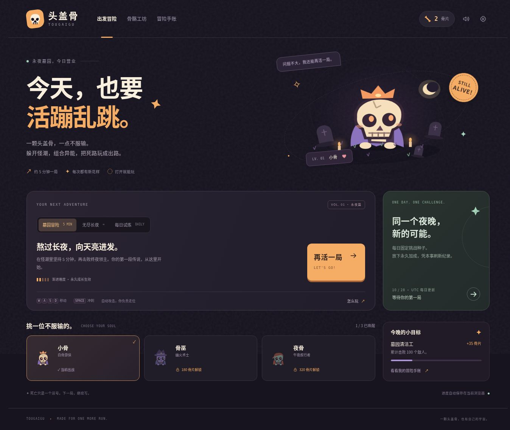

# 头盖骨 · 再活一局

**TOUGAIGU** 是一款中文、原创视觉、零运行时依赖的浏览器生存 Roguelite。

> 一颗头盖骨，一点不服输。躲开怪潮，组合异能，把死路玩成出路。

- 运行状态：已完成本地浏览器验收；线上发布尚未完成。
- 仓库：<https://github.com/zhangshuaibo1/tougaigu>
- 当前版本：1.0.0
- 仓库当前为私有；自定义域名 `tougaigu.com` 尚未绑定。



## 玩法

玩家控制一只小骷髅，在不断涌来的怪物中生存。攻击自动瞄准，玩家专注走位、收集经验、冲刺避险与选择升级。

一局的循环是：**走位 → 击败怪物 → 收集经验 → 三选一升级 → 组合流派 → 击败首领 → 结算骨片 → 永久强化 / 解锁角色 → 再来一局**。

### 三种模式

| 模式 | 目标 | 永久强化 | 角色 |
| --- | --- | --- | --- |
| 墓园冒险 | 生存至 300 秒并击败第三位首领 | 生效 | 已解锁角色任选 |
| 无尽长夜 | 持续增长的难度，挑战个人最好成绩 | 生效 | 已解锁角色任选 |
| 每日试炼 | 相同 UTC 日期对应固定种子，刷新当日个人纪录 | 不生效 | 固定为小骨 |

首领在 90、180、300 秒出现，标准模式需要实际击败终夜首领才算通关。因此常规一局约为五分钟或稍长。每日种子固定的是随机序列，不会替玩家做出相同的选择；移动、升级策略与操作仍然改变结果。

### 角色与成长

- **小骨 / 白骨游侠**：初始免费，110 生命，均衡的生存与火力。
- **骨巫 / 幽火术士**：180 骨片唤醒，85 生命，自带一级灵魂环绕。
- **夜骨 / 午夜疾行者**：320 骨片唤醒，90 生命，移动更快、暴击更高、冲刺冷却更短。
- 18 项局内升级、3 个组合进化、5 项永久强化、8 项一次性成就奖励。
- 常规敌人包括幽灵、蝙蝠、软糖、远程法师、冲锋怪；首领有独立攻击模式。

| 进化 | 条件 |
| --- | --- |
| 灵魂星环 | 灵魂环绕 4 级 + 脚底抹油 3 级 |
| 雷霆共鸣 | 天打雷劈 4 级 + 手速超度 3 级 |
| 白骨风暴 | 硬骨头 5 级 + 一骨三连 3 级 |

永久强化每级分别增加 4% 初始伤害、8 点初始生命、3% 攻速、10 点拾取半径或 2% 经验。每项最多五级，购买成本随等级增长。

## 操作

| 平台 | 移动 | 冲刺 | 其他 |
| --- | --- | --- | --- |
| 电脑 | WASD / 方向键 | 空格 | Escape 暂停；升级时 1 / 2 / 3 选择 |
| 手机 / 窄屏 | 左下虚拟摇杆 | 右下冲刺按钮 | 点击升级卡；左上暂停按钮 |

切换标签页或窗口失焦会暂停战斗。升级选择期间时间暂停。设置中可以关闭合成音效、减少动态效果、导出和导入存档。


## 存档与数据边界

- 成长进度使用当前浏览器的 `localStorage`，键为 `tougaigu.save.v1`。
- 钱包、角色、永久强化、成就、最近 20 局战绩及最近 30 天的每日最好成绩会保存。
- 坚持至少 15 秒才结算成长奖励；成就奖励只领取一次；同一局有唯一 ID 防止重复结算。
- 退出战斗会结算这一局。当前正在进行的战斗不提供跨刷新续局，刷新后开始新的一局。
- 导出 JSON 可以备份和跨设备迁移；导入校验版本、结构、字段与数值，并要求确认替换当前进度。
- 首发版没有账号系统、云存档、在线多人或全球排行榜。手账显示当前浏览器的真实战绩。
- 所有分数与奖励由客户端计算，适合单人娱乐；不能把本地记录当作防作弊竞技成绩。
- 不依赖付费模型 API、第三方图片/字体、分析埋点、广告或支付。

## 本地运行

无需安装 npm 依赖。使用任何能提供静态文件的 HTTP 服务：

```bash
git clone https://github.com/zhangshuaibo1/tougaigu.git
cd tougaigu
python3 -m http.server 8080 --directory dist
```

然后访问 `http://localhost:8080`。浏览器 ES modules 需要 HTTP 服务，不要直接双击 HTML 文件。

需要 Node.js 运行静态检查与测试：

```bash
npm run check
npm test
```

也可以逐个运行测试文件查看各场景：

```bash
node tests/engine.test.mjs
node tests/progression.test.mjs
```

## 项目结构

```text
dist/
  index.html     页面、游戏 HUD、原生对话框
  style.css      响应式视觉、战斗界面、窄屏摇杆
  app.js         页面交互、输入、结算与存档整合
  engine.js      Canvas 渲染、战斗、技能、首领、音效
  content.js     中文内容、角色、成长、存档校验
  favicon.svg   原创矢量图标
tests/
  engine.test.mjs
  progression.test.mjs
docs/
  QA.md
  homepage.jpg
  upgrade.jpg
  mobile.jpg
.openai/hosting.json
```

## 部署与域名

部署产物就是 `dist/`，无构建步骤。已创建的 Sites 站点身份和静态目录记录在 `.openai/hosting.json`，后续尝试仍应复用同一个站点。Sites 源码推送受执行环境审批限制，当前尚未发布，不应把预留站点地址当作可玩的线上地址。

GitHub Pages 的静态发布分支为 `gh-pages`，内容与 `dist/` 一致。当前 GitHub 账号的私有仓库设置页提示需要升级或公开仓库才能启用 Pages，因此没有自动改变源码可见性。取得允许公开此新游戏仓库的授权后，可在 Settings → Pages 中选择 Deploy from a branch → gh-pages → / (root) 并保存。

如选择其他服务，也可直接把 `dist/` 发布到支持 HTTPS 的静态托管平台。绑定 `tougaigu.com` 需要先确认域名所有权，再依据托管商实际给出的记录配置 DNS；本项目没有写入推测的 A/CNAME 记录，也没有替用户购买域名。

本仓库暂未授予开源许可，避免在未获作者决定前替作者选择对外授权条款。
