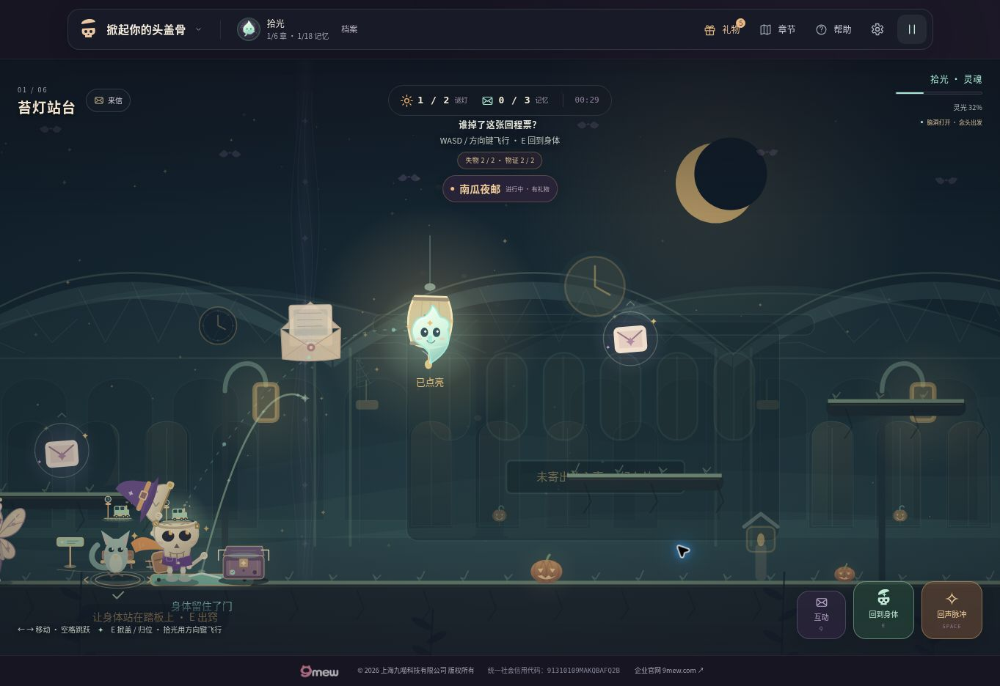
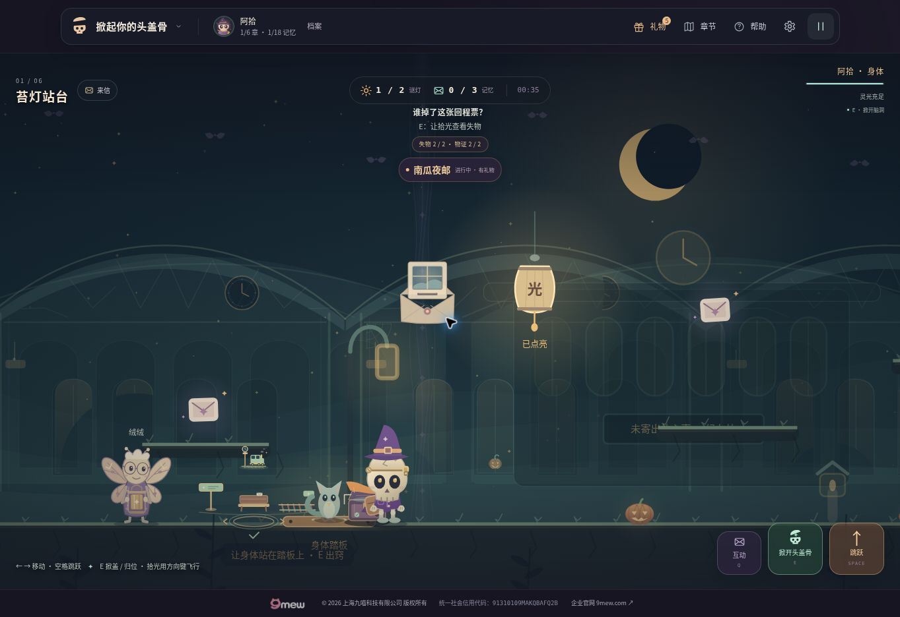

# v12 诗灯唤景验收

日期：2026-10-28。版本：12.0.0。

## 本轮交付

- 六章十二盏主线谜灯各对应一处现场变化：信封与投递窗、旧画旅客过海、春风裁叶、芝麻开花、故乡窗与空椅、纸月开幕、书页高窗、书签小鲸、竹篮归潮、旧表向前、信抵各窗、日月邮票。
- 每盏灯只在真实点亮后启动约1.8秒的展开，完成后保留终景。未解、错误作答、返回及重复确认不会提前展示或重播结果；先解第二盏时只出现该盏对应的小景。
- 小景在点灯时选定灯旁的位置，之后固定在世界坐标中。E归位和行走不使它跟随角色；暂停冻结，减少动态直接呈现终景。本局跌落保留，重新开章清空。
- 保留现有地图碰撞、机关、出口、谜题与奖励条件，不新增存档或结算。十个节日继续使用独立内容；邮局仅照暖局部窗沿，保留原结局选择。

实现与验证入口：[内容配置](../dist/dream-awakenings.js)、[Canvas绘制](../dist/dream-awakening-art.js)、[真实引擎回归](../tests/dream-awakening-engine.test.mjs)、[离线渲染脚本](../scripts/render-story-awakenings.mjs)。

## 自动与离线验证

- **25个测试文件、319项测试全部通过。** 内容与引擎验证包括十二题对应关系、严格索引、深冻结、错误与取消、重复确认、逆序点灯、暂停、归位、跌落、重开、减少动态、低帧率与节日隔离。
- 临时手机包装页`qa-v12-phone.html`已移除。清理后实际文件集为**33个JavaScript模块、100个本地引用、99个运行文件**；本地引用检查没有缺失。
- 六章均通过程序驱动的真实`DreamGame`行走、掀盖、飞近谜灯、点灯、归位与通关验证。此项属于离线引擎验证，不计为六章浏览器人工试玩。
- 离线Canvas渲染完成**60组纯度与确定性检查、48组绘制边界检查、12组重叠保护检查、12组减少动态终景比较**；未展开时无答案图像，终景不再随额外时间变化，暂停画面与Canvas状态恢复检查通过。
- 十二处小景分别通过桌面、320手机和390手机构图，合计**36组真实`DreamGame`整场渲染**。渲染包含实际镜头、角色、关卡与互动保护区域，不仅是孤立插画。
- [十二幅终景细节](awakening-details.png)和[五阶段展开图](awakening-stages.png)来自离线Canvas绘制，不是浏览器实操截图。

## 桌面浏览器实际操作

1. 在苔灯站台第一盏灯的谜题中，先选错误答案“鸟笼”，再返回关卡。谜灯仍为**0/2**，场内没有新增小景。
2. 再次按Q打开谜题，选择“信封”并继续点灯。场内出现信封、纸页与投递窗的展开，记录了展开阶段与落定后的画面。
3. 按E归位并继续行走，小景仍留在原来的世界位置，没有跟着身体或镜头漂移。
4. 实际暂停再恢复，游戏能够继续操作。

## 移动端验证范围与未完成项

两种手机视口的DOM量测已完成。离线验证采用页面量测得到的实际Canvas尺寸，而非把整块手机屏幕尺寸当作绘图区域：

| 外层手机视口 | 实际Canvas | 本轮已完成的验证 |
| --- | --- | --- |
| 320 × 680 | 320 × 431 | 离线真实引擎绘制十二处终景；通过HUD、底部操作区与画面可见范围检查 |
| 390 × 844 | 390 × 595 | 离线真实引擎绘制十二处终景；通过HUD、底部操作区与画面可见范围检查 |

引擎回归同时检查点灯时与展开结束后的可见性，要求小景至少95%的绘制边界位于HUD与底部操作区之间；归位后世界位置保持不变。

**本轮尚未完成手机浏览器实际操作验收。** 浏览器在手机视口打开章节地图时，自动化服务连续超时，重置会话（`js_reset`）也超时，未取得后续操作证据。上述DOM量测和离线真实引擎Canvas结果不能替代触屏作答、归位、暂停等浏览器实操，也不计为线上v12验收。

既有版本的手机与发布记录保留在各自文档中，例如[v11验收记录](QA-v11.md)；它们不作为本轮v12已经完成的证明。

## 发布

待部署验证。
