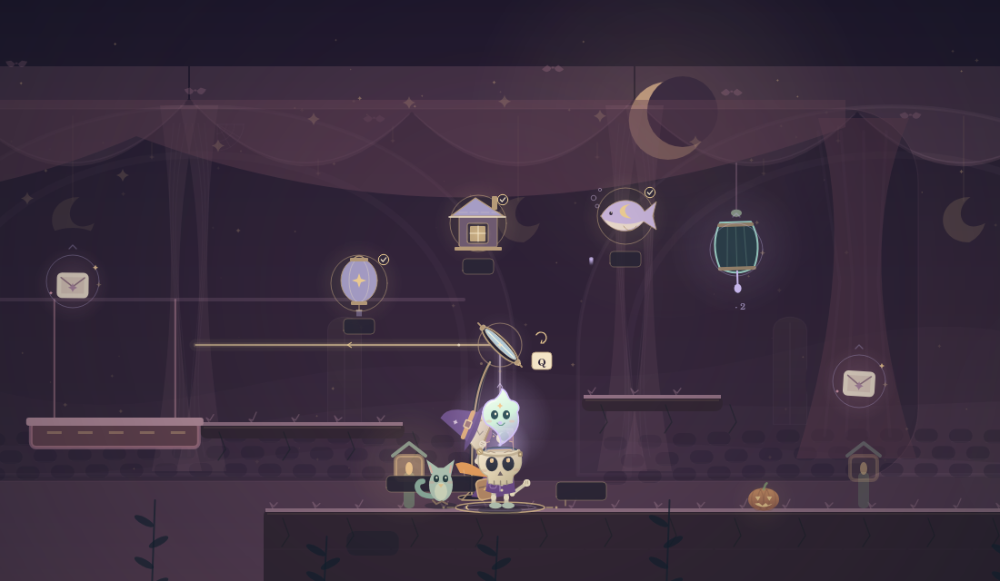
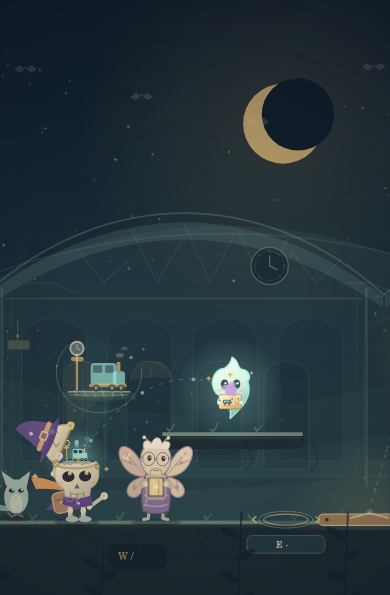
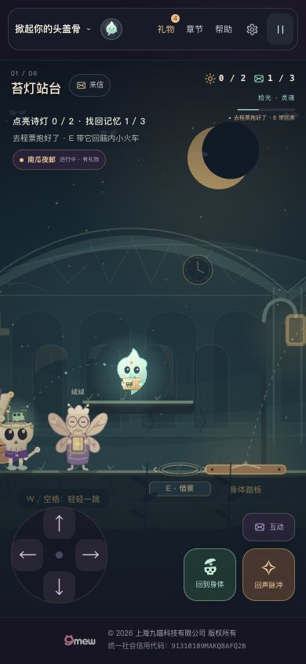

# v13 借月追光与第一张去程票

日期：2026-10-28。版本：13.0.0。承接主分支 v12，不重建游戏。

## 交付行为

- 借月剧场右岸增加独立月镜：身体站稳供光，拾光自由飞行决定入射光方向，靠近镜面用 Q / 空格切换三档镜角。反射依照实际光源与镜面计算，不自动瞄准目标。
- 三幕分别为「给空窗借月」「送晚风上场」「等一盏归灯」，共九个图景。持续照射约 0.45 秒后点亮，再用短动作展开。完成一幕后 E 归位、Q 换幕，各幕保留自己的镜角和点亮结果。
- 归位、离开、跌落与暂停不会清除已亮目标。暂停保留光源和光路并冻结展开；已点亮的图景在减少动态模式下直接显示终景。重新开始本章清空这一局的月镜小戏。
- 第一个站台记忆改为有齿边、撕票虚线、火车图案与星印的去程票。拾光实际拾取后抱票，归位到达头盖时收好；再次掀盖在脑内火车上显示。身体拾取直接收好。
- 票的持有与展示跟随真实记忆事件；读取已有脑洞画册时，只把已发现的记忆编号 0 恢复为展示，不补计本局记忆、不重放奖励、不推断旧主线的汇总记录。
- 既有谜灯、机关、借景、失物、节日、出口和奖励规则保留。月镜无新增存档键或奖励，票收藏沿用 `tougaigu.capbook.v1` 及旅途备份。

## 自动验证

28 个测试文件，354 项用例全部通过。`npm run check` 检查 36 个 JavaScript 模块与 104 个本地引用，无缺失。两份故事入口保持一致。

| 范围 | 证据 |
| --- | --- |
| 三组真实反射、27 种目标/镜角可达组合、持续照射与中断 | `tests/dream-moon-play.test.mjs`，13 项 |
| 真实引擎步行入环、飞行照景、换幕、主灯优先、耗尽/跌落/暂停/重开 | `tests/moon-play-engine.test.mjs`，7 项 |
| 实际飞行与身体跳跃拾取、抱票归位、快速 E、节日隔离、已存收藏、HUD | `tests/first-ticket-engine.test.mjs`，15 项 |
| 既有主线、生存、节日、奖励、存档、借景、失物与唤景 | 原 319 项回归 |

本轮修复了三个验收中实际发现的问题：暂停切减少动态后票的 HUD 提示落后于实际状态；票的新手提示覆盖既有导向铃/铜踏板提示；月镜固定镜头让手机上前往主线谜灯的拾光出框。另补齐月镜快照的 `canTurn` / `canAdvance`，使触屏按钮准确切换「转月镜」「换一幕」。

## 离线整场 Canvas

`scripts/render-moon-play.mjs` 检查三幕与九件物件的确定性、输入不变、上下文恢复、暂停和减少动态，共 24 项绘制检查。

`scripts/render-v13-scenes.mjs` 调用真实 `DreamGame` 渲染整场。桌面 1100×640、手机实际 Canvas 320×431 与 390×595 分别验证三幕完成图景和车票的抱住、归位、收好、再次掀盖四种状态，87 项断言通过。此脚本包含明确的离线位置夹具，不冒充浏览器实操。

小屏月镜取景为全部目标、充能圈、标签和人物留出范围；320 尺寸在顶部约 150 CSS 像素与底部 36 CSS 像素之间容纳图景。靠近右侧主线灯时解除固定镜头，恢复正常跟随。

执行环境的离线 Canvas 未安装中文字体，图中中文可能留空；图标、人物、光束及位置检查仍有效，中文页面需另用真实浏览器检查。

## 浏览器与发布

v13 已发布到原地址：[掀起你的头盖骨](https://zhangshuaibo1.github.io/tougaigu/)。

- 功能源码提交：[9c7f302](https://github.com/zhangshuaibo1/tougaigu/commit/9c7f30228eea37ea26a17c6ade7db5a06d70f0e3)。
- Pages 发布提交：[6175b9e](https://github.com/zhangshuaibo1/tougaigu/commit/6175b9e6d69af53663caf62158c65f9520584a55)。
- [GitHub Pages 发布流程](https://github.com/zhangshuaibo1/tougaigu/actions/runs/40762891344)已完成，结论为 `success`。源码 `dist/` 的 102 个运行文件与 Pages 根目录逐一核对，Git blob 均一致；发布分支保留 `.nojekyll`。
- 发布后刷新公开页面，读取到 `application-version=13.0.0`。桌面实际显示中文、去程票、新提示与既有企业页脚，掀盖切换到拾光、能量耗尽自动归位、暂停及继续可用。
- 在连接的 Chrome 将视口设为 390×844，通过可见方向按钮的按住操作实际飞行拾票：本局记忆从 `0/3` 变为 `1/3`，拾光抱票，HUD 显示「去程票抱好了」。点击归位后显示「去程票已上车」，再次掀盖可见票留在脑内火车上，记忆仍为 `1/3`。
- 320×680 视口下，实际 Canvas 为 320×431，页面宽度为 320，没有横向溢出；可见方向与动作按钮、帮助对话框正常展示。帮助页包含去程票流程和「借月追光」操作。验收后已恢复原视口。
- 本轮公开页面操作结束时读取浏览器警告和错误日志，结果为空。保留游戏页并暂停，避免空放消耗游戏时间。

以上窄屏检查使用桌面 Chrome 视口与指针输入，不等同于物理手机触摸验收。月镜三幕完成与手机取景已由上述真实引擎测试和离线绘制验证；本轮未在浏览器从起点通关到第三章，也未把离线位置夹具算作完整主线实机通关。开发环境本地预览未能由连接的浏览器访问，浏览器验收均以发布后的公开页面为准。

