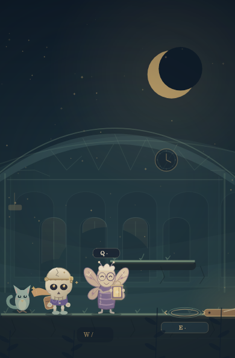
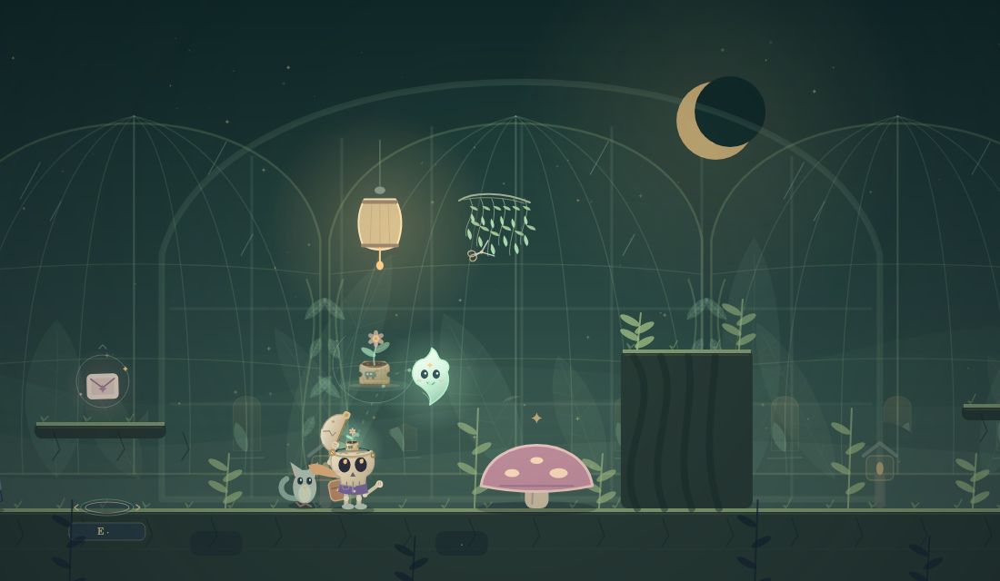

# v14 旧车票里的第一朵花

日期：2026-10-28。版本：14.0.0，承接 v13。

## 实际行为

- 第一章精确发现的去程票，决定第二章脑内使用票纸盆还是陶盆。票面保留原来的齿边、火车与星印。
- 温室第二片记忆变为旧靴口的一粒种子，保持原坐标和拾取规则。拾光托种、归位到达头盖后入盆；身体借蘑菇拾取直接种好。
- 空盆、入土、长叶、开花由种子是否入盆及精确诗灯集合决定。先取种、先点一灯、两灯后再取种都成立。种子仍可选，不改变出口条件。
- 生长演出在开盖时推进；合上盖子会保留当前动作，等下一次看见时继续。暂停冻结；减少动态落到已有实际阶段。已有记录在重访中静态展示，不自动补本局记忆或诗灯，也不重复发放收藏奖励。
- 绒绒先注意到抱票的拾光，目光跟随真实归位曲线；票落定后一次举灯、展翅，再回到暖灯待机。读档不重演欢迎。归位途中立刻交谈会描述正在回家，不声称票仍在站台，也不提前算作已上车。
- 前两章 NPC、开场、收尾及脑内短句按实际票/种子/叶/花回应。未落盆时不提前声称发芽，未找到时不虚构持有。
- 信箱改用精确残页编号，发现第二片只显示第二片；旧汇总成绩保留，但不据此猜出文字。
- 短期目标与就近操作分开；诗灯提示、可执行作用范围和「解谜」按钮使用同一边界。触屏/鼠标提示使用按钮名称，键盘使用 E/Q/空格；方向按钮支持原生键盘/读屏激活，并清理暂停、失焦、切形态、换章时的按住状态。

## 自动验证

32 个测试文件全部通过，共 402 项用例：v13 的 354 项，新增叙事事实 18 项、真实引擎旅途 15 项、UI/画册 8 项、方向输入 7 项。

`npm run check` 通过：40 个 JavaScript 模块、114 个本地引用。`git diff --check` 无空白错误，两份故事入口一致。

| 新验证 | 范围 |
| --- | --- |
| `dream-journey.test.mjs` | 精确编号、旧汇总隔离、异常数据、叙事条件、阶段去重、输入不可变 |
| `journey-engine.test.mjs` | 真实步行/飞行/蘑菇拾种、归位时刻、三种探索顺序、暂停/减动/快速 E/耗尽/跌落/重开、绒绒追视与一次欢迎、诗灯边界、归位中交谈、回调重开/销毁隔离 |
| `dream-ui.test.mjs` | 短目标、跳过可选票、按钮优先级、输入来源文案、画册静态阶段 |
| `dream-direction-input.test.mjs` | 原生语义激活、指针释放不重复、多指方向、旧计时器与重置、真实引擎移动/跳跃 |

既有 NPC 集成测试更新了前两章新 `journey` 数据和阶段首次对白的契约；后四章与十个节日保留原重复对话语义。

种子的真实飞行从章节出生点步行到左侧起飞点后进行；第二盏灯的顺序测试使用既有右侧检查点夹具隔离顺序，不将其称为整章实机通关。

## 美术验证

`scripts/render-v14-art.mjs` 的 232 项绘图断言通过，涵盖阶段首尾、输入与 Canvas 状态不变、确定性、减少动态和边界。它们属于绘图断言，不与上述 402 项游戏测试相加。

`scripts/render-v14-scenes.mjs` 使用生产 DreamGame 在 1100×640、320×431、390×595 三个 Canvas 尺寸生成 45 张完整场景帧，258 项布局与像素断言通过。抱票/欢迎、持种/归位/长叶/开花在暂停前后像素一致；关闭头盖保留生长动作。320px 温室第一灯的小景使用距灯仍为 128 的低斜向候选，画面框处于 187.75–252.40 CSS 像素，避开 150px 顶部保护区；头顶花园保护区内装饰侵入像素为 0。390px 和桌面的原布局保持。

离线场景夹具用于隔离视觉状态，不是浏览器完整通关。干净帧：

发布后的实际浏览器结果将在下节补充；未记录的检查不视为通过。

## 发布

此文件随 v14 功能源码准备发布。发布提交、部署结论和浏览器验证完成后将记录于此。
