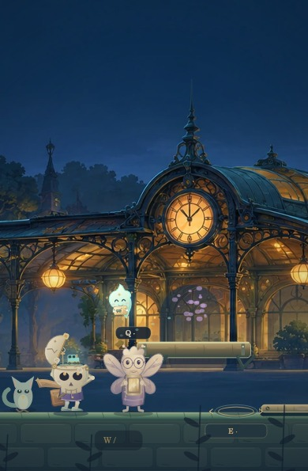
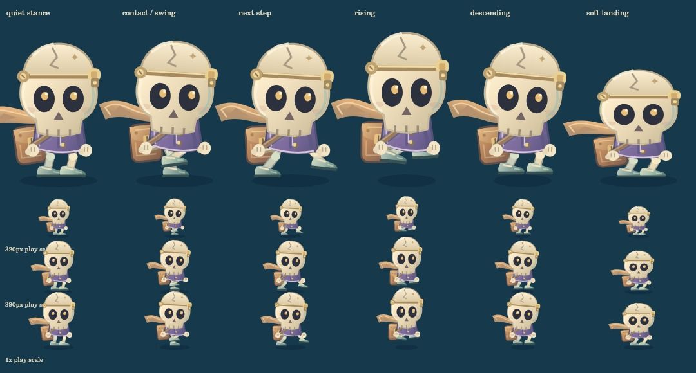

# v16 灯下的邮差

日期：2026-10-28（洛杉矶）。版本：16.0.0。承接已发布 v15 的 `a73c459` 运行时代码及 `cb5d13d` 验收记录。

## 实际改变

- 恢复此前未进入公开版本的原创精绘站台，原 PNG 与生成提示一同保存。生产资源为原尺寸 2172×724 WebP，266,328 字节，比原 PNG 减少约 86.5%；没有放大、裁切或改变构图。
- 精绘采用 0.28 视差，开场桌面和窄屏保留主站钟；两扇窗分别响应两盏真实诗灯。可操作平台、车票、踏板和转臂保持原坐标、碰撞和条件。
- 可互动谜灯使用深色柔暗衬底与标牌，绒绒增加翼膜、衣料和灯笼光影。
- 阿拾步态区分支撑脚与摆动脚：全速支撑不滑移，鞋底补偿原身体起伏和压缩，起跳收腿、下降伸脚。外套、围巾、鞋与邮包细化，头盖和双手表示仍与原引擎完全一致。
- 图片只在实际主线第一章加载一次；未完成、失败或 drawImage 异常时完整回退 v15。图片加载不能改变物理、收票、归位、进度或奖励；换章与销毁后的迟到图片不会复活旧场景。
- 三份 HTML 入口前置统一 importmap，同时版本化入口与 CSS。构建检查也覆盖模块内 new URL 的静态资源引用，防止发布时遗漏背景图片。

## 逻辑与资源验证

逐一直接执行 36 个测试文件，**439/439 项通过**：v15 的 411 项，加 13 项图片几何与生命周期、8 项真实引擎整合、7 项邮差运动测试。完整结果见 [verification-v16-local.json](verification-v16-local.json)。

新增验证覆盖真实输入收票、归位途中暂停后图片才就绪、换章/销毁与微任务竞态、加载失败回退后仍可踩踏板和点灯、当前回合与收藏展示隔离、五章与十节日绘制序列不变，以及脚底接触、摆腿弧线、步态周期连续、减动和绘制无副作用。角色独立审查发现的围巾周期跳变已修复并加入回归。

`npm run check`：44 个 JavaScript 模块、124 个本地引用、158 个版本引用通过；两份故事入口一致；`git diff --check` 通过。`dream-engine-base.js` 与 v15 保留的 v14 基类字节相同。

## 生产 Canvas 画面

`scripts/render-v16-traveler.mjs` 显式等待生产图片解码后，使用实际 DreamGame 生成桌面、320px、390px 共 12 张完整帧和 6 个动作夹具，73 项检查通过。拾票、持票、归位、入车使用真实引擎输入；暂停前后逐像素一致，减少动态装饰不受展示时钟影响，头盖与双手表示不变。

这些是离线生产 Canvas，不包含 HTML 界面，也不是全章浏览器通关证据。离线环境缺少中文字体，中文 HUD/标签由浏览器验收另外确认。本地 HTTP 服务可启动，但连接的浏览器无法访问该工作区的 localhost，因此不宣称本轮已经完成本地 HTTP 浏览器测试。

## 发布与公网浏览器

待记录源提交、部署提交、Pages 结论、实际版本与关键操作。没有记录的检查不视为已完成。

## 后续质量重点

把这一轮成熟的材质与动作方法推广到倒流温室，让种子、票纸盆、嫩芽和小花在正常游戏比例下更清楚；继续减少地面提示文字密度，延展寄出/保管选择的可见故事回响。仍未进行物理 iPhone/Android、Safari 或低端 GPU 性能实测。
