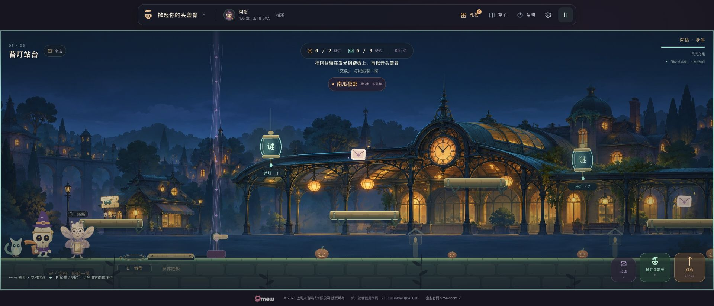
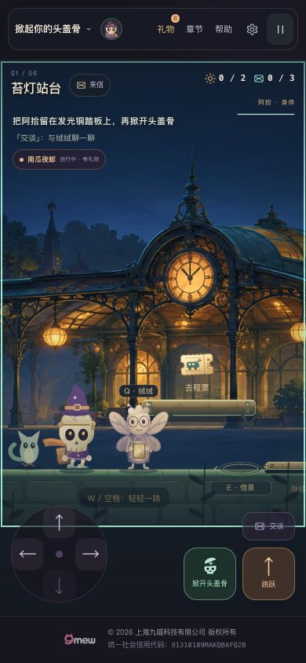
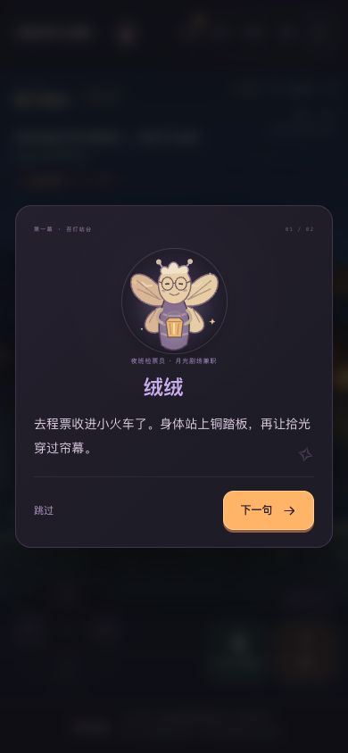

# v16 灯下的邮差

日期：2026-10-28（洛杉矶）。版本：16.0.0。承接已发布 v15 的 `a73c459` 运行时代码及 `cb5d13d` 验收记录。

## 实际改变

- 恢复此前未进入公开版本的原创精绘站台，原 PNG 与生成提示一同保存。生产资源为原尺寸 2172×724 WebP，266,328 字节，比原 PNG 减少约 86.5%；没有放大、裁切或改变构图。
- 精绘采用 0.28 视差，开场桌面和窄屏保留主站钟；两扇窗分别响应两盏真实诗灯。可操作平台、车票、踏板和转臂保持原坐标、碰撞和条件。
- 可互动谜灯使用深色柔暗衬底与标牌，绒绒增加翼膜、衣料和灯笼光影。
- 阿拾步态区分支撑脚与摆动脚：全速支撑不滑移，鞋底补偿原身体起伏和压缩，起跳收腿、下降伸脚。外套、围巾、鞋与邮包细化，头盖和双手表示仍与原引擎完全一致。
- 图片只在实际主线第一章加载一次；未完成、失败或 drawImage 异常时完整回退 v15。图片加载不能改变物理、收票、归位、进度或奖励；换章与销毁后的迟到图片不会复活旧场景。
- 三份 HTML 入口前置统一 importmap，同时版本化入口与 CSS。构建检查也覆盖模块内 new URL 的静态资源引用，防止发布时遗漏背景图片。

## 逻辑与资源验证

逐一直接执行 36 个测试文件，**439/439 项通过**：v15 的 411 项，加 13 项图片几何与生命周期、8 项真实引擎整合、7 项邮差运动测试。完整结果见 [verification-v16-local.json](verification-v16-local.json)。

新增验证覆盖真实输入收票、归位途中暂停后图片才就绪、换章/销毁与微任务竞态、加载失败回退后仍可踩踏板和点灯、当前回合与收藏展示隔离、五章与十节日绘制序列不变，以及脚底接触、摆腿弧线、步态周期连续、减动和绘制无副作用。角色独立审查发现的围巾周期跳变已修复并加入回归。

`npm run check`：44 个 JavaScript 模块、124 个本地引用、158 个版本引用通过；两份故事入口一致；`git diff --check` 通过。`dream-engine-base.js` 与 v15 保留的 v14 基类字节相同。

## 生产 Canvas 画面

`scripts/render-v16-traveler.mjs` 显式等待生产图片解码后，使用实际 DreamGame 生成桌面、320px、390px 共 12 张完整帧和 6 个动作夹具，73 项检查通过。拾票、持票、归位、入车使用真实引擎输入；暂停前后逐像素一致，减少动态装饰不受展示时钟影响，头盖与双手表示不变。

这些是离线生产 Canvas，不包含 HTML 界面，也不是全章浏览器通关证据。离线环境缺少中文字体，中文 HUD/标签由下述公网浏览器另行确认。本工作区的 localhost 未通过连接的浏览器访问；CI runner 独立启动的本地 HTTP 候选站点则已完成浏览器验收，两者是不同环境。

## 发布与公网浏览器

v16 已发布至原地址：[掀起你的头盖骨](https://zhangshuaibo1.github.io/tougaigu/)。候选 `dist` 的 **111 个运行时文件与 gh-pages 逐文件一致**，发布分支额外保留 `.nojekyll`。原始候选与公网报告、资源请求、人工检查摘要保存在 [verification-v16-public.json](verification-v16-public.json)。

| 证据 | 标识与结果 |
| --- | --- |
| v16 运行时代码 | [c6438b744da7f26f0fe8cd0f30a3eb93edf099de](https://github.com/zhangshuaibo1/tougaigu/commit/c6438b744da7f26f0fe8cd0f30a3eb93edf099de) |
| 测试脚本修复及通过验收的源码状态 | [9099206986d2e81d3e3e989998302fb50c694f5b](https://github.com/zhangshuaibo1/tougaigu/commit/9099206986d2e81d3e3e989998302fb50c694f5b)；修复没有改变已部署运行时 |
| Pages 发布提交 | [d09c3009d996472d2979f697ae05bf5cfda300df](https://github.com/zhangshuaibo1/tougaigu/commit/d09c3009d996472d2979f697ae05bf5cfda300df) |
| Pages 工作流 | [40798348886](https://github.com/zhangshuaibo1/tougaigu/actions/runs/40798348886)，success |
| 完整验收工作流 | [40798906987](https://github.com/zhangshuaibo1/tougaigu/actions/runs/40798906987)，success；[job 123201995711](https://github.com/zhangshuaibo1/tougaigu/actions/runs/40798906987/job/123201995711) 全部步骤成功 |

### 首次 CI 失败与修复

[首次验收 40798347185](https://github.com/zhangshuaibo1/tougaigu/actions/runs/40798347185) 在 1280px 收票阶段失败，错误为 `window.__qaRead is not a function`。测试脚本的 `**/dream-app.js` 路由没有匹配新入口 `dream-app.js?v=16.0.0`，因此未注入只读坐标探针；这次失败不能算作游戏操作验收通过。

修复仅作用于 `scripts/browser-smoke.py`：精确匹配入口文件及可选查询串，导航后检查探针就绪，并把实际插桩 URL 写入 `instrumentedAppURLs`。桌面通关、错误答案、触屏、暂停和存档等原有断言全部保留。修复通过 Python 语法与 10 组 URL 匹配检查后，重新执行完整候选和公网浏览器流程，得到上述成功结果。

### CI 浏览器实际覆盖

以下范围在 CI 的本地 HTTP 候选站点与实际 GitHub Pages 公网地址分别执行，各有三个视口，共六个 case。测试给入口模块临时附加只读坐标查询，操控仍使用真实键盘事件、DOM 按钮与 Chromium 模拟触摸；没有注入存档、传送角色或直接调用解谜完成接口。

| 视口与输入 | 实际通过范围 |
| --- | --- |
| 1280×800，键盘 | 从起点飞行收票、归位、重新开盖不重复计数、暂停冻结、身体踩踏板、第一题错误答案不点灯且不能继续、两道诗灯正确作答、身体走进出口完成第一章；重载后实际脑洞画册存档保持一致 |
| 390×844，模拟触屏 | 方向与动作按钮收票、归位、重新开盖不重复计数、暂停冻结、无横向溢出；本 case 不包含整章通关 |
| 320×680，模拟触屏 | 同上；本 case 不包含整章通关 |

六个 case 的页面版本均为 `16.0.0`，`pageErrors` 与 `httpErrors` 均为空，可见 DOM 图片加载通过；记录的 JavaScript/CSS 请求均使用 `?v=16.0.0`，精绘 `station-painted-v16.webp` 在每个 case 中实际请求。桌面报告明确记录 `chapterCompleted: true`、`reloadPreservedCapBook: true`；两个窄屏报告明确记录 `chapterCompleted: false`，不把局部流程当作整章通关。

[CI 截图与完整产物](https://github.com/zhangshuaibo1/tougaigu/actions/runs/40798906987/artifacts/12865441588) 的工作流保留期为 3 天，原始 JSON 报告已另存本仓库。报告中的 60 帧间隔采样仅对应开场静止阶段的 CI 环境，不代表整段游戏的帧率，也不代表物理手机或低端 GPU 性能。

### 连接 Chrome 的人工检查

在公开页面实际查看 1920×824、390×844 与 320×680 视口，确认精绘站台与中文界面正常显示，390px 与 320px 无横向溢出。390px 的绒绒两句对话能够翻页并继续出发；原有档案仍显示 1/6 章、3/18 记忆。人工检查记录的控制台错误为空。

上述人工检查使用桌面 Chrome 的视口调整；它与 CI 模拟触屏均不是物理 iPhone/Android 测试。Safari、物理手机和低端 GPU 性能仍未实测。

## 后续质量重点

下一轮确定为 **v17 倒流温室精绘与材质**，尚未完成、发布或验收。将第一章成熟的方法推广到温室，让玻璃、木架、植物及前景平台保持一致的层次，并确保种子、票纸盆、嫩芽和小花在正常游戏比例下清楚可辨。保留真实生长阶段、诗灯与拾取条件，继续处理提示密度；寄出/保管选择的可见场景回响属于后续内容，不能提前记为已实现。
