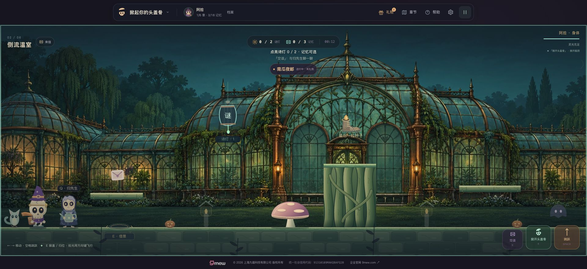
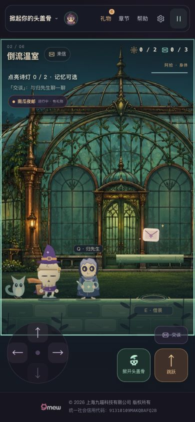

# v17 倒流温室：验收记录

日期：2026-10-28（America/Los_Angeles）。

## 当前状态

已发布，候选 Chromium 和公网 Chromium 已分别完成测试。这一节记录实际验收，不将离线画面误当公网测试。

## 实际改动

- 原创 2172×724 温室精绘按第二章按需加载，生产 WebP 508,666 字节；保留原 PNG、提示词与 SHA-256，见 `ART-DIRECTION-v17.md`。
- 玻璃、铜框、植物与远景形成景深；两扇窗分别响应本回合的两盏真实诗灯。旧收藏不提前点亮本局场景。
- 石砖地面、苔藓木台、盘根高台和弹床蘑菇使用原碰撞尺寸；蘑菇压缩回弹读取原物理状态。
- 阿拾沿用 v16 邮差动作和材质；温室的种子、票纸盆、嫩芽、小花仍由真实拾取、归位与答题推进。
- 生产资源加载或绘制失败时回落到原可玩温室。其余章节、节日、奖励和存档保持兼容。

## 已执行检查

| 检查 | 实际结果 |
| --- | --- |
| `npm test`，并逐文件核实子测试汇总 | 462 项 / 39 个文件，全部通过 |
| `npm run check` | 46 个 JS 模块、128 个本地引用、164 个版本引用通过 |
| `scripts/render-v17-greenhouse.mjs` | 156 项检查通过，24 张离线生产 Canvas 画面 |
| 离线行为 | 正常输入拾种、归位、种植、两盏灯、蘑菇弹跳；暂停像素冻结；减动；不重复记忆；渲染不更改玩法状态 |
| 目视 | 桌面入场、蘑菇弹跳、320px/390px 花归位与可玩轮廓 |

离线截图不含网页 HUD，不是浏览器或物理手机测试。`verification-v17-local.json` 记录此次复验的真实结果。

## 浏览器验收范围

候选和公网 CI 均已以真实键盘完成第一章，正常解锁并进入第二章，飞取种子、暂停归位、种入票纸盆、回答两盏灯（含错误答案）、踩蘑菇越根台并走到出口；随后检查重载存档。390×844 和 320×680 通过 Chromium 模拟触屏验证第一章收票归位、暂停与布局。窄屏范围不包含整章通关。

该脚本只在测试请求中加入只读观察接口，所有移动和解谜使用正常输入，不向游戏注入坐标、完成状态或奖励。实际执行状态在发布后补齐。

## 仍需提升

人物与伙伴相对精绘背景仍较简化；下一轮继续归先生材质、表情与“寄出／保管”的可见场景回响。暂无实体手机、Safari 或低端 GPU 性能实测结论。

## 发布后闭环（2026-10-29 UTC）

- 主分支运行时代码 `80007d24052caf7114be8744f5d6bb796744a060`，Pages 提交 `fed37ac54e51cf4a25c3b57366502571610ef1b8`；[Pages 部署工作流 40813316272](https://github.com/zhangshuaibo1/tougaigu/actions/runs/40813316272) 成功。
- [候选工作流 40813054860](https://github.com/zhangshuaibo1/tougaigu/actions/runs/40813054860) 与 [main/公网工作流 40813319511](https://github.com/zhangshuaibo1/tougaigu/actions/runs/40813319511) 均成功。462/462 个 Node 用例、46 个 JS 模块、128 个本地引用与 164 个版本引用通过。
- HTTP 候选与公网各有 1280×800、390×844、320×680 三组浏览器案例，均实际返回版本 17.0.0，可见图像全部加载，无页面脚本错误及 HTTP 错误；三视口均无横向溢出。
- 桌面采用真实键盘完成第一章和第二章：收票归位、两盏谜灯、错误答案不计分、温室拾种/落盆/开花、蘑菇弹跳跨越根台、进入第二章出口、重载后保留记忆与灯。两种窄屏仅测试第一章模拟触摸拾票/归位/暂停，**没有**宣称完成窄屏整章。
- 实际公网 1280×800 与 320×680 全屏截图已目视检查：温室远中近景、人物、谜灯、蘑菇和控制区可辨认。原始报告/PNG 位于工作流 artifact，有限期保留；永久摘要见 [verification-v17-public.json](verification-v17-public.json)。
- 首屏空闲片段 60 个 requestAnimationFrame 样本的中位数约 16.7ms、95 分位 16.7–16.8ms。它不是整章帧率/能耗测试，更不代表实体手机。物理 iOS/Android、Safari 与低端 GPU 仍未测试。

## 补充公开 Chrome 现场检查与完整报告

已在原公开地址实际读取17.0.0，查看1920×880桌面与390×844温室。中文、角色、现有万圣节装扮与控制区正常，390px没有横向溢出。v17另完成NPC两句对话和320px掀盖/界面检查。新截图如下；其余浏览器范围和实体设备限制仍按上文，不扩大模拟触屏的通关结论。

为保留既有自动续跑核验记录，`verification-v17-public.json` 的原摘要保持完整；从相同成功CI日志提取的候选与公网逐case完整数据另存为 [verification-v17-browser-report.json](verification-v17-browser-report.json)。

