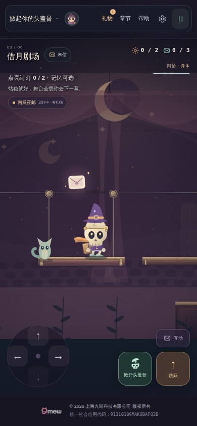

# v19 借月剧场·稳稳登台：开发与验收记录

开始时间：2026-10-29 04:00 UTC。

## 当前状态

v19已发布并完成本轮验收。实现、本地检查、候选浏览器、Pages发布与main/公网复验均已完成；公开Chrome已实际读取19.0.0。

- 基线main：0a2785c1abb947f5775708646e0d79801acd1ecd。
- 本轮分支：iteration-v19-theatre-20261029；当前会话负责完成实现、候选验证、部署与公网验证。
- 后续续跑如看到本轮近期提交或未完成CI，请先接续这条分支并核对实际进度，避免另起同版或竞争发布。

## 本轮范围

第三章移动舞台木板、支承结构、黄铜部件和真实接岸高光；第三章复用精修邮差材质与步态，影子落到实际承载面；现有HUD补充等台、登台、乘台、下台的短反馈。保持关卡几何、物理、存档、奖励和其他章节原互动。

## 已完成的本地检查

- npm test：44个测试文件全部通过；候选CI进一步确认504项实际子测试全部通过，0失败。
- npm run check：50个JavaScript模块、135个本地引用与176个19.0.0版本引用通过。
- git diff --check与Python浏览器脚本语法检查通过。
- 新增8项平台绘制、8项登台提示、9项投影、5项引擎集成测试；包括2000帧与旧物理逐帧一致、旧交互提示优先、渲染纯度、暂停、减动与前两章图像缓存隔离。
- 离线生产Canvas：66项检查，21张完整画面；1100×640、390×595、320×431三个画布均从真实出生点通过jump/setInput登左岸、等台、登台、乘台、走下右岸，零次跌落，约15.28模拟秒。没有设置人物坐标、舞台位置或完成状态。
- 暂停后整幅Canvas像素一致；减动忽略装饰时间；接岸高光只改变真实重叠顶边的像素。已查看正常比例桌面、390px和320px实际离线图。

离线画面没有网页HUD，中文字体受离线环境限制；不是浏览器、模拟触屏或物理手机证据。原始离线报告保存在verification-v19-local.json。

## 可玩变化与兼容

木台板、舞台裙板、黄铜连接件、吊索与随真实移动距离转动的滑轮；台面顶边严格对应p.y，台宽严格对应p.x…p.x+p.w。接岸亮边来自同高实际交集，不用另一个动画时钟。

第三章采用现有精修邮差材质和步态，增加紫色月光反射。身体阴影查询真实level.platforms、运行时movers与未开障碍，选择脚下最近的可承载面，按高度变淡收拢并裁在平台内。下方没有表面的坑洞不绘制地面影子。

原提示位置显示等台、登台、乘台、下台的短句；NPC、诗灯、月镜等现有互动优先。上下台提示要求真实同高且舞台与岸边交集大于1像素。全程没有新增存档键、奖励、碰撞或第二个动画循环。

## 候选浏览器与发布

- [候选工作流40816162223](https://github.com/zhangshuaibo1/tougaigu/actions/runs/40816162223)成功，对应源码[45cfb080](https://github.com/zhangshuaibo1/tougaigu/commit/45cfb080f868f071e9d4be8b8086458ca7e0924f)。完整数据在[verification-v19-candidate.json](verification-v19-candidate.json)。
- 保留并真实执行前两章键盘通关、温室send/keep分支、日记改选、暂停与重载检查，然后从正常已解锁地图进入第三章。键盘过首段舞台后正常重启，再以390×844模拟触摸重复过台。未注入坐标、存档或完成状态。
- 键盘与390px触摸均真实观察等待、接合登台、body.platform=stage、松方向随台、接合下台与右岸落脚，零次跌落。无输入承载距离分别为182.30与182.00世界像素，角色相对舞台漂移均为0；平台段没有自动解灯或结算章节。
- 原390×844和320×680独立触摸用例继续覆盖第一章收票、归位、再次掀盖、暂停和布局。候选三个case均19.0.0，页面/HTTP错误为零。已查看完整桌面与390px候选网页截图，包含真实中文HUD和操作区。
- 发布提交[e21aca04](https://github.com/zhangshuaibo1/tougaigu/commit/e21aca04b379a4485eae5a3d8449d32bd4503471)；[Pages40816584342](https://github.com/zhangshuaibo1/tougaigu/actions/runs/40816584342)成功。源码dist树219c690bafbfb9d1eef367fa6a1709e273ea730b与发布树259fcd6af4b584bc9a6ef40a98fa5782b3138970的118个运行时blob SHA全部一致，仅另加.nojekyll。
- [main/公网工作流40816586535](https://github.com/zhangshuaibo1/tougaigu/actions/runs/40816586535)成功：再次通过504项逻辑测试、静态引用、候选浏览器与真实公开地址浏览器检查。main工作流候选和公开各三个case均为19.0.0，页面/HTTP错误为零，完整数据在[verification-v19-public.json](verification-v19-public.json)。
- 公开地址实际通过前两章键盘通关、寄出/保管信件分支、日记改选及重载后，正常进入第三章；键盘、390px模拟触摸均零跌落过首段移动台。公开检查的无输入承载距离分别为186.84和184.03世界像素，相对舞台漂移均为0，原章结算记录保持不变。
- 已查看下列公开地址的1280×800与390×844完整网页截图，中文、现有万圣节装扮、引导与操作区正常；这些图片来自上述成功公网浏览器运行，没有替换背景或合成界面。

390px第三章路线复用真实键盘解锁前两章的同一份存档，通过正常重启进入第三章后使用触摸事件；该范围不是整章或全程手机通关。实体手机、Safari与低端GPU性能尚未取得验证证据。

## 公开页面实景

## 后续重点

本轮精修移动台和角色落脚关系，第三章背景仍是原有较简洁布景。下一轮优先原创精绘绒幕、黄铜台口、木质包厢和观众席，细化两盏主线诗灯及其真实点灯环境反馈。具体范围见[ITERATION](ITERATION.md)。
