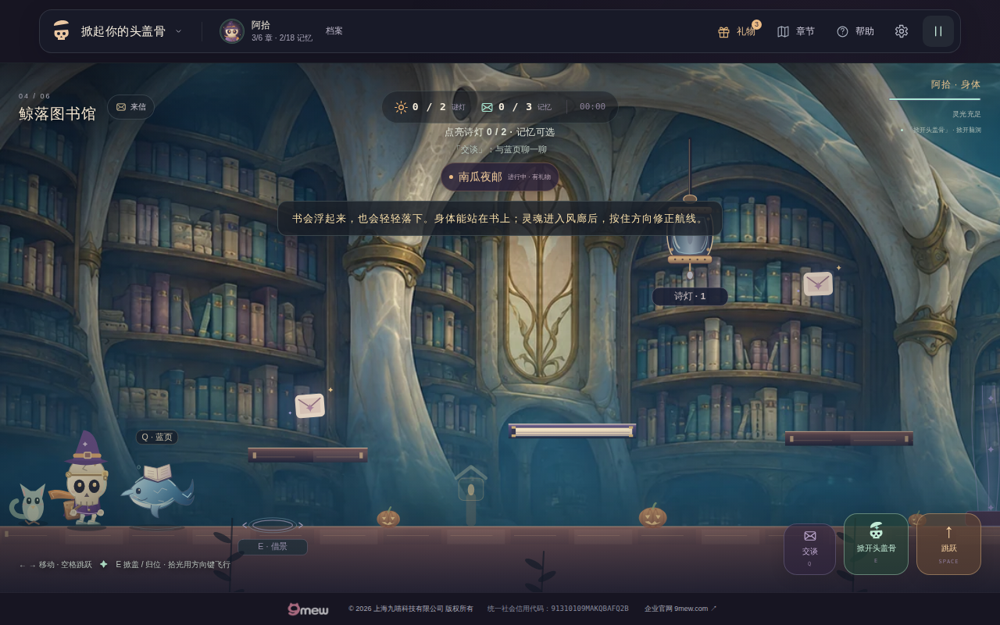

# v26 鲸落图书馆·路上慢读：正式发布记录

**v26.0.0 已在 https://tougaigu.com/ 发布，现有候选、Pages、main/公网工作流全部通过。** 本记录按真实执行范围收尾；原计划中尚未实际完成的第四章触摸与故障路线继续由 [v27计划](PLAN-v27.md) 承接，不追认已通过。

## 发布与原始证据

- 最终运行源码 `ae2c35ed255dbbe6470f2c9850664666d0b7b6e6`，继承域名配置与普通故事读页解码修复；随后 `88e7cd11c84af46c95268de95d2564a031432f2e` 仅归档域名文档。
- [最终候选40861470337](https://github.com/zhangshuaibo1/tougaigu/actions/runs/40861470337)、[Pages40862243927](https://github.com/zhangshuaibo1/tougaigu/actions/runs/40862243927)、[main/公网40862236514](https://github.com/zhangshuaibo1/tougaigu/actions/runs/40862236514) 全部 success。main验证于2026-10-29 11:12:36 UTC完成，全部步骤成功。
- Pages `b02381bc89875cf63b5f4815e43c2a2e3e87a482` 的130个运行blob及模式与源码dist一致，仅额外`.nojekyll`；`CNAME`保持`tougaigu.com`。
- **570/570**测试，无失败/取消/跳过；58个JS模块、151个本地引用、200个26.0.0版本引用通过。
- 原始 [候选报告](verification-v26-candidate-full.json)、[公网报告](verification-v26-public-full.json)、[发布清单与完整边界](verification-v26-release.json) 已保存。artifact 12892262582，150495891字节，SHA256 `ce8685449ccd7cca419fcd433dbdb7926fdbd350f363c556c086fa2b3d9ab464`；207条归档路径及软链接安全检查通过，未执行归档代码。

## 实际通过的游玩范围

候选与公网各1280×800、390×844、320×680均显示26.0.0，页面异常和HTTP状态错误为空。桌面从前章正常解锁进入第四章，完成三页开场、蓝页交谈、掀盖、真实登乘两本浮书、两盏谜灯、风廊、真实脉冲冻结危险物、3记忆及身体出口，零死亡与一次结算。登乘快照鞋底Y等于真实书面Y；这两张快照不等于完整无输入周期。第一灯光量[.54,0]、双灯[1,.54]，目录门由真实灯状态开启。

结尾三页头像逐页解码，clock先取消后有真实第五章补答门禁；选择release并进入第五章后重载仍保留。日记改选hold时验证选择与奖励不重复，但未再重载。前三章严格单跳、暂停和头像故意取消预算仍通过；第四章末尾requestfailed缺口见下节。

[双灯实景](v26-live-two-lamps.png) · [320px入口](v26-live-entry-320.png) · [蓝页交谈](v26-live-npc-talk.png)。根会话亲自检查前三张原尺寸全页截图；320/390第四章当时只覆盖桌面context缩窗入口与HUD，不是第四章触摸通章，也不是实体设备。

## 明确移交v27的缺口

1. 精确requestfailed检查位于第四章之前，之后只查pageErrors/httpErrors；补最终逐请求严格核账，不能以泛化ERR_ABORTED豁免修补。
2. 蓝页普通两页及clock release/hold回音没有逐页decode证据；复用正常阅读助手。
3. 390/320实际触摸两本浮书、风廊、第二灯和归位；两书无输入完整升降周期。
4. 第四章主图真实失败下的完整可玩路线、原响应迟到及离场后迟到清理；现有共享loader单元测试不替代这些浏览器用例。
5. hold真正重载、双灯后返访蓝页、第四章真实暂停/减少动态；相同输入完整路线物理等价与NPC实际像素边界。

不因上述缺口否认已经发生的部署与成功CI，也不把它们包装成已完成的原计划。第五章新增场景与clock可见回响会连同这些实际问题一起交付。没有实体手机、Safari或低端GPU结论。

## 历史记录

以下为早期候选时的原始记录，其中“未发布/待完成”描述当时状态，当前发布以本文上半部分及原始报告为准。

# v26 早期候选记录（历史，保留原失败与当时边界）

状态：**v26.0.0仍是候选，尚未合入main或部署到正式GitHub Pages。** 严禁把本文件中的候选浏览器测试当作已上线或实体设备验收。以远端最新分支/工作流与发布记录为准。

## 已完成的可玩增量

在严格 `mode==='story' && chapterIndex===3` 条件下，把归档的 2172×724 / 178156字节 WebP 精绘接入第四章运行时，前景世界仍由原引擎绘制；真实的两本浮书承载面、风、危险物、目录门、两盏谜灯、玩家与出口不改碰撞。新增纸页木边与黄铜物件材质，蓝页小鲸通过原 NPC 视图随近身/掀盖与本局谜灯状态响应；两个场景暖光区只跟真实本局诗灯推进。继续使用原阿拾/拾光绘制与基础物理，v25第三章舞台表演不延伸到图书馆。主背景失败回退原程序布景，未改存档格式/奖励/clock选择。原位图的Git blob同源：`c7a7d9473f2a55ceef9fcab1df3876545452145b`，原SHA-256为 `6e32b91fc56890f6362590eb2bfe0ccd0858389aeeb5de5aac72b5cb02dcab03`。

## 可复核的真实结果

- [候选CI 40853977902](https://github.com/zhangshuaibo1/tougaigu/actions/runs/40853977902) 在提交 `5d2d04fd69b95f96f4e79b7cdbcfeb4bb196621c` success。**569/569** Node测试通过；检查 **58个JS模块、151个本地引用、200个26.0.0版本引用**，全部为生产代码候选检查，不是公开站点。
- 候选 Chromium 1280×800：从正常第一、二、三章进度解锁并进入第四章，三页开场解码、蓝页近身与按Q交谈、E掀盖、真正登上book-a与book-b、两灯解题、拾光冻结原漂游影子、收三记忆、身体进出口，零死亡。两本书实际身体鞋底Y与浮书物理面完全相等；单灯光量 `[0.54,0]`，双灯光量 `[1,0.54]`，相应目录门真实开启。
- 结尾真实读三页，原clock选择弹窗先Escape，企图进第五章会强制补答；正常按钮 `release` 后第五章/刷新保留，再从日记改为 `hold`，没有重复结算、授奖或篡改letter选择。
- 1280/390/320 Chromium 均显示候选 **26.0.0**，3个独立case的页面异常与HTTP错误为零；桌面完整第四章，390/320真实页面全屏及HUD检查位于桌面浏览器正常进章后的缩窄视口，另有独立手机尺寸第一章模拟触摸与节日返回测试。**不能称为手机第四章双浮书实操或实体设备验收**。
- 用同一工具路径的工作流 artifact `game-verification-5d2d04fd69b95f96f4e79b7cdbcfeb4bb196621c`（Artifact ID `12888543876`，自动保留期限至2026-11-01）读取 `candidate/report.json`、原始1280/390/320截屏、资源数据及runner输出。本轮亲自复核原比例 `1280-library-entry.png`、`1280-library-two-lamps.png`、`1280-library-entry-320.png`，观察角色、浮书和灯能在实际场景内辨识；截图SHA-256分别为 `aeb2c0fc21e226d5bc5e235dc7dbc77b5d62bd3f67b2cf88d312b321a4356e0b`、`9c51d6a77f8c24ba9637562629ca8d3444dcf91de38e7d863100bf4283671d7b`、`2e506bb594e813b270ee376d173b247e4043b4fe6a52283982b296614def86ad`。
- 初次候选 [40852835403](https://github.com/zhangshuaibo1/tougaigu/actions/runs/40852835403) 因ESM缺括号失败，修复后新候选通过，旧失败记录保留。

## 在途发布与风险

自定义域名绑定的main提交 `03a46bc4` 发生在v26候选分支建立之后。必须先合并最新main，保留`dist/CNAME=tougaigu.com`、`gh-pages/CNAME`、`.nojekyll`、新HTTPS CI地址及域名存档迁移说明。域名首次完整公网CI [40858951757](https://github.com/zhangshuaibo1/tougaigu/actions/runs/40858951757) 能正常访问HTTPS，却因旧连续读页助手不等待归先生头像decode而报告额外 `ERR_ABORTED`，没有通过；须在新候选下重新严格验收，不能放宽资源错误门禁。

待完成：验证新的逐页头像decode修复、第四章正常与坏图回退的实际浏览器行为、390/320真实浮书触摸路线；严格候选通过后才发布，逐文件比对dist/gh-pages并在HTTPS公网完成关键交互，再升级本文为正式QA并规划下一轮。尚无物理iOS/Android、Safari及低端GPU性能证据。
