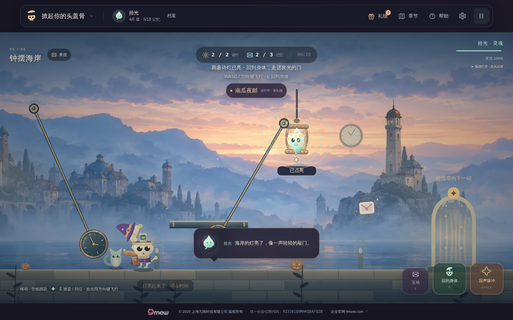

# v27 钟摆海岸·向前一秒：发布与验收记录

**状态：v27.0.0 已发布到 https://tougaigu.com/，候选、Pages 与正式域名完整浏览器回归全部通过。最终main工作流于2026-10-29 12:33:26 UTC成功结束；原始双侧报告、源快照与正式截图已独立复核。**

## 已完成的候选与实际发布

- 候选源码 `f0a86fca370153668141f11de25b7285b9e09eaa`，[工作流40870056725](https://github.com/zhangshuaibo1/tougaigu/actions/runs/40870056725) **success**：605/605 tests，61模块/157本地引用/209版本引用通过；浏览器步骤实际500.7836654秒。公网步骤因候选分支规则跳过。
- 正式源码 `73fe30b751e6fa46d01ded252fb6f3c34c19cc04` 保留v26归档与v27全部原画/基线/验证记录；Pages `8ee328d1741f737755e7f6c7082bcf951163a7b9`，[部署40871794254](https://github.com/zhangshuaibo1/tougaigu/actions/runs/40871794254) **success**。134个runtime blob与候选dist完全一致，仅额外保留.nojekyll；CNAME仍为tougaigu.com。
- 用户连接的Chrome实际重载正式入口，DOM版本27.0.0、模块引用27.0.0、无横向溢出。此手工检查停留在第一章入口，完整第五章证据来自真实候选浏览器与下述公网工作流，不混称。
- [main完整回归40871791153](https://github.com/zhangshuaibo1/tougaigu/actions/runs/40871791153) **success**：605/605测试，候选和正式HTTPS两侧各3个case均27.0.0，页面/HTTP错误为空，最终资源加载成功、失败请求账单逐条完全匹配。候选497.4875081秒，公网498.6368487秒；整run17分50秒，保持25分钟原预算。

候选原始ZIP大小116,282,946字节，SHA-256 `d6c60148e3a26971641927831fec9b5067b17c6e8e1792afc2de6505ee355e3f`；146个路径安全，commit.txt精确匹配，224个生产/脚本/测试/版本/工作流源文件逐字节相同。完整原始报告1,958,596字节，未裁减。

[候选完整原始报告](verification-v27-initial-candidate-full.json) · [候选artifact审计](v27-candidate-artifact-audit.json) · [发布逐blob核对与正式DOM](verification-v27-publication.json)。根会话实际查看了海岸NPC、双灯、320入口、320浮书、两种playing Canvas和两种settled整屏，中文、HUD与角色层次可读。

候选已补齐第四章本轮门槛：390/320两本浮书完整无输入周期分别7.400/8.450及7.467/8.383秒，最大脚底误差与相对横漂均0；精确失败图完整通关，延迟及离场迟到均使用原响应；所有普通剧情逐页头像解码，双灯返访及两选择重载通过。海岸桌面完整身体通关零死亡，越过三个完整危险右界时实际冻结余量1.1667/1.1167/2.1167秒，一次结算并经真实地图进入第六章。海岸手机范围仍为安全入口触摸/回响/暂停/归位，不含手机钟摆通关；海岸坏图浏览器范围仍为安全入口与恢复。

全部章节后的最终网络账单精确7条：2个指定头像abort、3个剧场故障、1个图书馆故障、1个海岸故障；无额外失败。三个case的pageErrors/httpErrors均为空、finalImagesLoaded=true。失败请求不被泛化忽略。

## 正式公网最终证据

最终artifact `12896194998`：223,874,243字节，SHA-256 `992cdee35d2f7deb68d9a1510754e007ef4ca2db72a71db057e7157a1719b227`；287个路径安全，commit.txt精确为73fe30b，224个生产/测试/脚本/版本/工作流源文件逐字节相同。代码没有从artifact执行。

[正式发布审计](verification-v27-release.json) · [最终候选原始报告](verification-v27-candidate-full.json) · [完整公网原始报告](verification-v27-public-full.json)。两份报告保留原始字节，初始候选报告另行保留。完整工作流artifact按GitHub保留期存在；上述报告、精选原图、源代码、原画与离线证据已进入仓库。

公网实际第四章390两书完整周期为7.417/8.433秒，320为7.467/8.383秒，四段脚底误差均0；两个延迟场景均原响应完成且无handler错误，hold真实重载保留。公网第五章越三摆完整危险右界的剩余冻结为1.0833/1.1500/2.0500秒，零死亡且一次结算，经真实地图进入第六章。两种clock在0.2333秒真实演出时暂停，六个被动RAF机会中状态与Canvas保持冻结；恢复后2.8秒落定，同局再掀不重播。

根会话亲自查看全部6张正式原图：

[海岸与归先生](v27-live-coast-entrance-keeper.png) · [320px海岸入口](v27-live-coast-entry-320.png) · [320px真实乘浮书](v27-live-library-book-b-320.png) · [release演出Canvas](v27-live-clock-release-playing-canvas.png) · [hold演出Canvas](v27-live-clock-hold-playing-canvas.png)。前四张为完整页面；后两张为实际暂停时导出的完整Canvas，没有外层HUD。入口部分帧包含原有开场闪烁，未修图或拼接。

正式范围与候选一致：第四章手机双书/双谜/归位，不扩写成手机身体出口；海岸手机为安全入口触摸/回响/暂停/归位，未做手机钟摆全路线；海岸坏图浏览器只到安全入口与恢复，坏图整章来自离线三尺寸路线。未进行实体手机、Safari或低端GPU验收。

## 本轮可玩变化

第五章专用雾蓝海岸、暖灰石镇与铜顶远景使用2172×724原创绘图，生产WebP仅71750字节。真实石岸顶边严格贴合原平台矩形，铜钟摆的悬点、中心、半径与冻结倒计时直接读取实际危险物。阿拾与拾光的既有精修材质延伸到第五章，归先生沿用骨质、银发和斗篷细节，手里的铜怀表与双手共用实际抬手位置。

前章已有clock选择不再只有文字。第五章第一次真实掀盖，在原投影后出现2.8秒回响：release的纸鲸飞向向前走的怀表，hold展开留灯的书页窗口。回响结束后，头内仍留下对应微缩景观。暂停冻结；减少动态直接呈现静态结果；同局再次掀盖不重复，重开和日记改选更新展示。保持既有选择ID、存档键、奖励、谜题、物理与第六章结尾语义。

日记改选时如果头盖已经完全打开，关闭日记恢复游玩后直接呈现新分支；若头盖闭合，则等待之后真实掀盖。再次选同一个选项不重播。这是及时显示玩家新选择的展示行为，不要求玩家为了查看改选结果额外合盖重开。

海岸资源与回响严格限定story chapterIndex4。背景失败回退完整原程序布景，第一至第四章画作不能替代海岸。手机附近NPC改用通用“交谈”标签，键盘操作仍由真实HUD提示。

## 已完成的实际本地证据

- 静态检查：61个JS模块、157个本地引用、209个27.0.0版本引用；语法及git diff空白检查通过。
- 新增海岸14项、clock13项、浏览器driver纯验证8项通过；最终本地完整套件64个测试文件全部通过（Node 24按文件汇总），候选工作流将重新核定实际统一测试计数。
- 六条第五章离线完整路线：1100×640、390×595、320×431各正常生产WebP与加载失败。使用冻结v26输入tape，1285次update、21.4167模拟秒，2灯3记忆、三摆安全经过、真实身体出口、零死亡，物理/真正事件/一次结算与BaseGame逐步一致。仅入口chapterIndex4夹具；不是浏览器解锁或触摸验收。
- 另以实际浏览器driver的数字单轴策略做离线采样敏感性检查，30/60/90ms读取下依然能安全经过；浏览器IPC与真实页面成本仍待CI，不将此当作浏览器通过。
- 六个回响场景覆盖两选择×三视口，原引擎真实掀盖、播放、暂停/减动及归位；展示调用不推进物理。真实向右输入让拾光移开后，头区release/hold有可见像素差，确认持久微缩景观确实出现在角色内，而非仅单独画出的素材。
- 根会话亲自查看原尺寸桌面入口、风区和多摆、两种playing回响、两种持久头内景、320回响与出口。远景建筑与真实可踩面分开，右侧远塔在窄屏出口可见。

[完整离线摘要](v27-verification/verification-summary.json) · [数字控制敏感性](v27-verification/digital-coast-report.json) · [原画与来源](art/coast-v27/asset-manifest-v27.json) · [提示词](art/coast-v27/prompt.txt)。原图生成1次、编辑0次，PNG原字节保留，转WebP不缩放/调色。

### 准确的离线限制

本地Node Canvas没有中文字体，中文标签的glyph像素不完整，因此上述离线截图只验证游戏图形与布局，不能据此声称中文标签或真实网页HUD正确。中文与完整DOM最终依真实Chromium候选/公网截图检查。没有实体手机、Safari或低端GPU报告。

## 实际修正与失败历史

1. 初版海岸沿用左对齐2400px远景，右侧灯塔与第二灯背景反馈在窄屏出口被裁掉。改为最终右岸对齐；按真实点灯相机把第一光区放到可见的中段远镇，第二光区保留远塔。三视口实际点灯/出口的对应光区均可见。
2. 新布局在小数逻辑视宽的右端产生约1e-13的边界误差，严格“No exposed horizontal edge”单元测试失败。生产布局将x限制在`[viewportWidth-imageWidth,0]`后13项海岸测试通过；没有放松断言。
3. 三个历史渲染测试仍要求第五章与旧Base绘制完全一样，与本轮明确视觉变化冲突。保留第六章及全部节日的原绘制比较，保留第一章资源在第五章不加载的旧检查，并新增缓存前四章画作不覆盖海岸的独立负例；第五章完整物理等价仍严格核对。
4. 浏览器第五章结尾实际回到章节地图，不会自动开始第六章。驱动已使用真实地图按钮进入，不通过写状态或篡改剧情修正测试假设。
5. 独立画面审查发现归先生原布尔掀盖回应会瞬间抬表11px。本轮仅海岸改为读取实际capOpen连续抬起与回落，怀表与两个手腕共用lift；归位时仍随尚未闭合的头盖自然落下。

## 本轮浏览器门槛（候选与正式站均已通过）

保留旧头像竞态、第三章严格跳跃/落地/暂停及精确错误清单。AST核对原43个函数/类不变，仅main接入新流程、tap_control兼容真实Locator。

- 第四章普通NPC与clock逐页解码；release和hold真实重载；双灯返访蓝页；真实暂停下状态与Canvas冻结。
- 390/320真实CDP触摸登乘两浮书，每本观察一个完整无输入周期，真实解两灯和归位；320同时验证真实减动设置。此范围不包含手机第四章身体出口。
- 精确阻断第四章唯一WebP，以原布景真实完成整章；原响应延迟、离场迟到、解除故障恢复和奖励不重复。
- 第五章从已正常完成第四章的进度进入，真实日记改选两个分支、首次掀盖演出/暂停/不重播/hold重载；390/320安全入口触摸与减动，明确不包含手机钟摆通关。
- 第五章桌面真实两灯三记忆、三摆在实际冻结期通过完整摆幅右界、零死亡身体出口、一次结算、读完三页后经地图进入第六章。
- 海岸坏图真实浏览器只验证安全入口移动与恢复；完整坏图通章由离线六路线覆盖，二者不混称。
- 最终requestfailed核账位于全部章节/故障流程之后，对每个已证明的故意请求故障逐项完全匹配；任何额外失败均拒绝，保留前三章原有门槛。

## 发布

本轮已完成严格候选、整屏检查、134个dist blob同步、Pages部署及正式HTTPS完整回归。`tougaigu.com`的CNAME和`.nojekyll`均保留，源代码与部署逐blob一致。下一轮预备为[黎明邮局·最后一封，一起送](PLAN-v28.md)；原画与第六章改前输入基线已保存在独立分支，v28运行时代码尚未接入，不能作为v28已发布。
