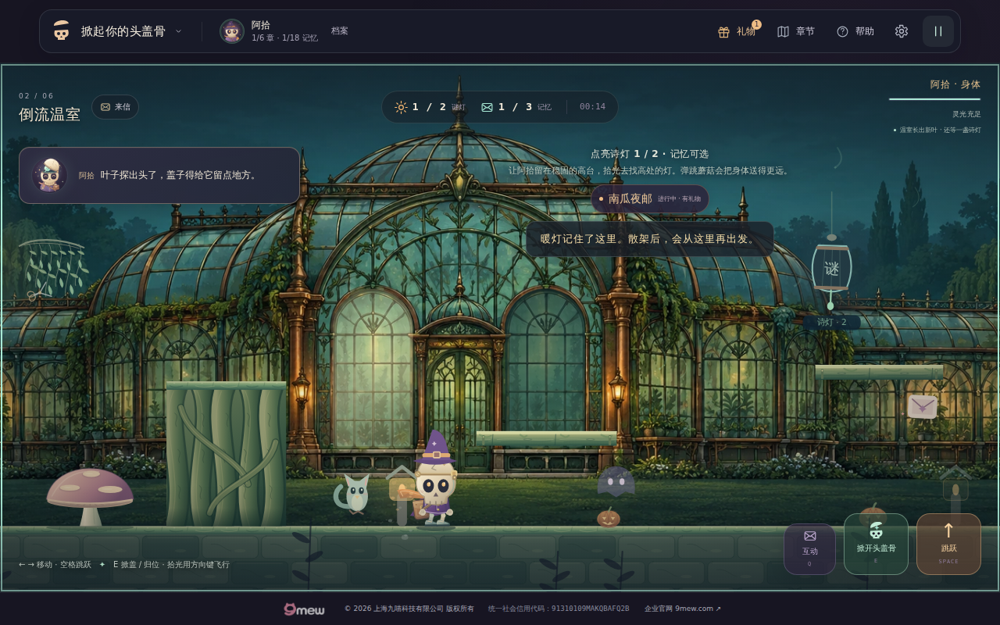

# v32 验收：给对白留一点空地

**发布状态（2026-10-30 UTC）：第二正式候选 ce412 已通过完整官方浏览器与独立产物审计；v32 Pages 已部署，五项实际 HTTPS 资源精确匹配。main 本提交后的完整候选＋正式 HTTPS 回归仍待实际结果。** 当前游戏入口为 [tougaigu.com](https://tougaigu.com/)。[候选40982421518](https://github.com/zhangshuaibo1/tougaigu/actions/runs/40982421518) 与 [Pages40984296820](https://github.com/zhangshuaibo1/tougaigu/actions/runs/40984296820) 已成功；不能以此替代完整线上游戏验证。

## 具体改动

至少 900px 的普通故事中，左侧对白与右侧目标／公告分栏。小于 900px 的布局及特殊模式保持原组织方式；新容器不改变原元素 ID、ARIA、剧情头像与事件。角色对白的 3800／5800ms 原时长没有改变。运行时只修改 `cap-play.css`、`dream-play.css`、相同的 `index.html`／`dream.html`；`survivor.html` 仅更新统一资源版本。143 个运行文件中，138 个保持原字节。

## 第二正式候选与准确部署

正式提交 `ce412d1298d0060dec08893f9b44cead9693edcf`，tree `1d0dd1a3a860b5571050db0e5f138f0a58f30261`。[完整候选40982421518](https://github.com/zhangshuaibo1/tougaigu/actions/runs/40982421518) 的浏览器于00:53:31—01:06:04 UTC成功。官方683/683测试通过，913源码文件内容与模式逐一匹配，143运行文件与第一候选a892精确相同，旧675个TAP子测试名完整出现。

完整六章、三视口、旧严格动作／物理／邮局／结局／重载与最终网络核账均经独立重新验证。三个主视口严格故意失败清单为9/0/0，页面、HTTP和额外网络错误均为0。原完整报告、205张PNG的尺寸与哈希、59份即时原JSON见 [第二候选归档](v32-formal-candidate/second/README.md)。本次public步骤按候选规则skipped，不能称为线上通过。

本次官方温室归位记录是“对白可见、公告不可见”，越根记录是“对白已自然消失、公告可见”；不要将两次不同观测拼成同帧共存。六配置矩阵全部通过，12份JSON／12张原图精确匹配；同帧公告和对白共存来自三个普通首站opening。Canvas和控件成对外框最大差0px；这是旧CSS消融对照，不是完整旧版运行。

Pages提交 `91ccef79541f2dd061059462c10d60cbecbed144` 的tree为 `321e762d63088910a73b60a9b3cc7fb5344e8f9d`，恰好143个已验运行文件加空`.nojekyll`，CNAME保持tougaigu.com。01:12:16 UTC，index、dream、survivor、cap-play.css、dream-play.css五项实际HTTPS均200且逐字节匹配ce412；见 [发布记录](v32-release/README.md)。主分支完整HTTPS回归将在本提交触发，当前不提前宣称通过。

## 已实际执行的本地验证

| 项目 | 实际结果 |
|---|---|
| 完整代码测试 | 76 个测试文件通过，0 失败；保留本机输出的计数口径 |
| 本地资源检查 | 68 个 JS 模块、171 个本地引用、232 个 32.0.0 资源引用通过 |
| 六个独立配置 | 20.642 秒，全部通过 |
| 完整浏览器脚本 | exit 0，752.294 秒 |
| 原完整流程 | 六章、390／320 模拟触摸、终章、三种结局、四组回信重载、资源失败／迟到及严格末尾网络核账均执行 |
| 三个主视口 | 32.0.0；页面错误与 HTTP 错误为 0；末尾图片加载完成 |
| 故意请求失败 | 按原精确清单为 9／0／0，无扩大忽略范围 |

六个配置是 `900×800`、`899×800`、`1024×640`、`900×520`、`1280×800` 系统减少动态，以及 `1280×800` 游戏内减少动态。它们是六种配置，不能称为六个不同场景，也不能当成实体手机验证。

实际执行 tree：`5445a39ba818484952598bfeab24d70702424a6b`。完整报告为 15,521,306 字节，SHA-256 `90219d4f982c6a92985aee50752452bed0e6c32d51cfdc2f0d68d242faf7605b`。随后只增加证据文档，得到归档 tree `ad30abdd5852d171c5853b706e86695748ff5aff`；运行时、scripts、tests 与 package 仍是实际执行字节。

完整说明见 [本地结果](v32-prestudy/LOCAL-RESULTS.md)，原始报告压缩包与图片索引见 [证据清单](v32-prestudy/evidence/local-5445a39/evidence-manifest.json)。此处没有把这些本地结果改写为正式 GitHub 或公网结果。

## 原尺寸画面与只读布局核验

根会话检查了真实温室越根后的旧／新画面；新布局中对白与公告同时出现时，主角面部和脚边可见。两张温室图来自各自实际流程中的不同时间，不作为逐像素同帧 A/B 证明。

六配置的 12 份观测快照与完整报告精确一致，12 张原图尺寸正确；对照中 Canvas 和控制区域外框最大差为 0px。该结论是几何外框不变，不是整张游戏图片像素相同。899px 明确走旧布局，未误用桌面主角边界断言。

[短屏开场](v32-prestudy/evidence/local-5445a39/900x520-opening.png) · [899px 旧布局](v32-prestudy/evidence/local-5445a39/899x800-ticket.png) · [系统减动收票](v32-prestudy/evidence/local-5445a39/1280x800-os-reduce-ticket.png)

普通开场的即时快照包含新手公告与双句对白；稍后截图可能已自然消退，不能写成同一帧。南瓜夜邮的标签不是公告。温室是实际叶子对白与检查点公告并存的观测。

## 失败与修正历史

### 首次正式候选：自然对白采样时机

首次正式候选 `a892471e6a4f87f534bb16434b4b9097bba10223` 的 [40979746320](https://github.com/zhangshuaibo1/tougaigu/actions/runs/40979746320) 在温室根台右侧落地后要求对白仍可见而失败。官方原 JSON 中人物已在 `x=1213 / y=560` 落地，对白原句存在，但 `visible=false`。官方没有记录对白时钟，不能反推该次 E 的准确时刻。

本地只读因果诊断发现，原采样接近对白的 3800ms 自然寿命；E 若早于原有 1600ms 防打断条件，还会保留旧对白计时。第二候选把 v32 新增的严格可见性采样移到原生归位闭盖后、跨根前，同时保存一次可信 E、原计时实际刷新和同一 run／章节以及身体坐标和 grounded 状态稳定。该处继续严格要求自然对白可见、文字完整、头像解码、真实 rig 投影避让及 Canvas／控件几何正确。

根台落点仍保存布局读取并检查实际可见元素；对白已自然消失时据实记 `bubbleObserved=false`，不声称那一刻完成了有对白的角色避让检查。原蘑菇弹跳、根台上方经过、落点、后续平台、两盏灯与零死亡断言保持。产品计时、剧情、输入和物理未改，143 个运行文件逐 blob 等于首次候选。

修正后的单次温室定向流程通过：旧对白年龄 1713.7ms 时的可信 E 刷新计时；闭盖事件读取为 746.6ms，随后严格 DOM／rig 快照为 766.2ms。根台落点读取时为 4014.3ms，对白已自然隐藏，路线仍零死亡完成。76 个测试文件与 68 JS／171 本地引用／232 版本引用均通过。这些定向结果不替代新的完整正式候选或 HTTPS。

原官方失败、原日志、准确源码审计及本地诊断见 [首次正式失败](v32-formal-candidate/first-failure/README.md)；修正原图、事件与报告见 [定向修正](v32-formal-candidate/timing-correction/README.md)。

### 较早的本地矩阵：CSS 夹具恢复

第一轮独立矩阵在恢复旧 CSS 对照时，使用 `link.disabled` 的异步重新加载导致 Canvas top 断言失败。仅把测试夹具切换改为已加载 `StyleSheet.disabled` 的同步恢复与 finally 清理；没有修改运行时布局来迎合测试，没有放宽任何断言。

原失败的 [日志](v32-prestudy/evidence/local-5445a39/initial-failure-log.txt) 与 [原始报告](v32-prestudy/evidence/local-5445a39/initial-failure-report.json.gz) 保留。随后六配置和完整原游戏脚本均重新执行并通过。

## 正式候选保护与后续验收

正式候选基于 v31 main 75010，保留两份 main 的 v30 审计及双方历史。首次 12 项代码增量来自本地实跑版本，包括必需的 `tests/fixtures/v32-layout-v31-css.json`；第二候选仅在两个验证脚本和一个验证测试中修正上述采样。邮局 `scripts/browser_post_v28.py` 继续保持 2050 目标、`2000 <= body.x < 2120`、零死亡、同 run／body 身份和所有原连续输入门槛。

正式候选原artifact／准确源码、Pages全部运行文件逐path／SHA／mode、自定义域名和五项HTTPS资源核对均已完成；剩余本main提交的32.0.0完整候选＋正式HTTPS浏览器和末尾网络核账，必须取得实际结果后才能关闭本轮。

## 已知边界

没有穷举最长剧场台词加公告、大字体、所有高平台和整套服装，也没有实体手机、Safari、低端 GPU 或 FPS 基准。六配置不能替代全部特殊模式的逐像素对照。v31 的 320px 抬盖配件左缘裁切仍是已有边界，v32 没有声称解决它。
