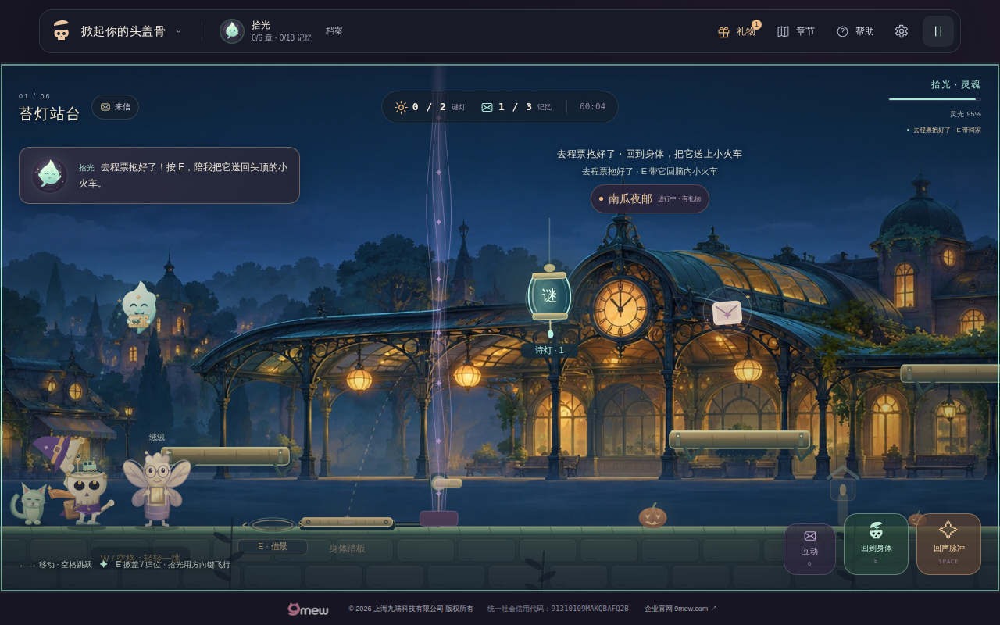

# v33 验收：小旅伴·抬头等你

**发布状态：33.0.0 已部署，正式候选与原始产物独立核验通过，七项实际HTTPS资源精确匹配；main完整候选＋公网回归仍待本提交实际结果。** 候选为 `1d63072bb9a27690ed14b15d3103c6e8a87fa297`，[40984114609](https://github.com/zhangshuaibo1/tougaigu/actions/runs/40984114609)于2026-10-30 01:23:21 UTC完成候选浏览器，public正确跳过。随后v32 main `93655a7` 的 [40984854669](https://github.com/zhangshuaibo1/tougaigu/actions/runs/40984854669) 完成真实HTTPS并通过独立审计，才发布本33；v32最终证据完整继承于 [归档](v32-main-release/README.md)。

## 改动与保护边界

原小猫增强了口鼻、脸部明暗、耳内、分开的双爪和尾缘；实际拾光的位置驱动视线与抬头。归位中即使 `form=body`，视线也继续读取本帧实际返回的拾光。眨眼只取原归位最后三分之一，重新掀盖和减少动态不会留下旧眨眼。重生后的清理由原cap重置与无独立眨眼状态的代码审阅支持，本轮没有单独驱动一次重生。

所有主世界坐标、跟随模拟、阴影原点、碰撞、能量、存档与奖励规则保持。base engine 原 SHA-256 为 `688e3006296e9d18fbaf49135b7b82b72d949539dcdc9387acefb224aab58699`，本提交保持该字节。新绘制位于独立模块，薄子类增加24行；三HTML与package统一33.0.0，完整浏览器末尾增加9行专项入口。另在测试入口补2行：省略版本参数时取本地package声明值，原首屏断言立即核对；显式参数仍优先。workflow不改。

本帧只复用 base 的同一个 presentedSoul，未追加角色姿态或归位计算。render 的 finally 恢复外层作用域；standalone drawCompanion 没有该作用域时回原绘制，0 次额外 getter。无 context／body／options／level 时安全返回；正常 destroyed render 由 base 原守卫结束，不声称销毁后直接调用旧画猫入口也零绘制。

## 正式候选验收

| 项目 | 正式候选实测 |
|---|---|
| 源码身份 | 996源码blob及模式精确匹配Git；144运行文件、257受保护源码，仅九项批准变化 |
| 测试 | 691/691通过，失败／跳过／取消均0；旧683测试名、76测试文件和fixture完整保留 |
| 完整浏览器 | 790秒；1280×800键盘、390×844与320×680模拟触摸；原6个跳跃、4条邮局路线、6次手机结局阅读和4个桌面结局组合通过 |
| 网络 | 保留原严格9/0/0预期故障清单；额外请求、页面与HTTP错误均0 |
| 对白布局 | 六配置、12个即时JSON／原PNG，成对Canvas和控件最大差0 CSS px |
| 小旅伴专项 | 32.595662565秒；三配置472次快照记录，21张原PNG精确核验 |
| 小旅伴行为 | 看实际返回拾光、末段眨眼、闭盖恢复、可信反转输入、暂停和游戏内减动通过；身体仍在(105,560)，0死亡，只取首张票、未结算章节 |

完整原字节报告、独立审阅、精确清单与选定原图见 [正式候选归档](v33-formal-candidate/official/README.md)。root另行核验46文件的准确转存、十个gzip载荷及59个原始即时JSON，见 [转存检查](v33-formal-candidate/official-root-transfer-check.json)。快照数量是记录出现次数，不是唯一动画帧数；对象引用身份由原单元测试证明，不从JSON推断。暂停Canvas字符串未留在报告，原脚本已在本次正式运行中实际比较相等。

首次汇总审计继承了前一轮表情PNG恰11张的计数假设，本次实际多捕获一张第一灯freeJoy，原11张均在。只修正汇总器为12个准确名称，原face校验器、阈值及产品未改；错误与重放记录保存在正式归档。这个审计计数修正不能写成产品或GitHub工作流失败。

## 准确部署与待验范围

Pages提交为 `d997c58b2a846b2673b8baec500db9697a846d7a`，tree `ef9072b947447304f4561855a8db58fb7fc42211`，包含144个准确候选运行文件与空`.nojekyll`，原CNAME保留。[Pages40987732103](https://github.com/zhangshuaibo1/tougaigu/actions/runs/40987732103)成功；01:46:30.860 UTC首页、dream、survivor、新小猫模块、engine与两份样式实际HTTPS全部200且逐字节相等，见 [发布记录](v33-release/README.md)。

这七资源核验不能替代完整线上游戏。本main提交继承最新32历史、最终真实HTTPS证据与33官方候选证据，全部运行／验证源码保持候选1d630准确；必须等本main完整候选和实际HTTPS的新报告及审计后关闭33。

## 本地准备验证（原记录）

| 项目 | 结果 |
|---|---|
| 当前33.0.0代码测试 | 77个测试文件，691/691测试通过；失败、跳过为0 |
| 资源检查 | 69 JS模块、172本地引用、235个33.0.0资源引用通过 |
| 当前33.0.0专项浏览器 | 34.316秒，1280×800键盘、390×844与320×680模拟触摸全部通过 |
| 当前专项行为 | 自然归位、仍看返回拾光、末段眨眼、闭盖；暂停Canvas字节不变；E反转清理；游戏内减少动态 |
| 游戏与网络 | 同局身体位置保持、只自然拿到首张票、未结算章节；0死亡、页面／HTTP／请求错误均0 |
| 源码稳定性 | 本地执行前后受保护源码逐SHA-256一致，见execution.json |

当前33.0.0结果见 [完整报告与清单](v33-formal-candidate/local-33/manifest.json)。原32.0.0预研与适配分别保留自己的源码归属和报告：预研41.897秒、24张原PNG；接口适配32.371秒、21张原PNG。它们没有被改写成当前33.0.0证据。

[320px原图](v33-formal-candidate/local-33/png/320/after-neutral.png) · [320px归位眨眼原Canvas](v33-formal-candidate/local-33/png/320/return-arrival-blink-canvas.png) · [390px实际归位原Canvas](v33-formal-candidate/local-33/png/390/return-returning-canvas.png)

完整八项专项测试覆盖实际归位边界、E成功反转与低能量拒绝、不可见双E、暂停、减动、六章逐步物理对照及render、十个节庆模式的旧绘制回退、同对象身份、异常、重入、无context和destroy后的render。正式调用适配确认导入不加载smoke、调用后自建contexts释放且不关闭调用者browser，并能严格拒绝错误预期版本。

上述本地执行后仅补充测试入口的两行版本默认值。该准确源码片段和原首屏断言已独立执行有值／无值／错误版本的入口验证，见 [入口检查](v33-formal-candidate/local-33/version-entry-check.json)；未为这项调用层修正重复本地浏览器，也没有回写原报告或源码哈希。游戏运行代码与原执行仍精确一致；本次正式候选已经运行并审计最终全部验证源码，原本地差异记录继续保留。

## 正式验证的边界与后续

候选完整脚本保留 v32 修正后的自然归位对白观察和原全部路线、动作／物理与严格网络清单。三尺寸小旅伴专项在原全套和六配置对白矩阵之后执行，使用同一候选／公网URL与明确版本；失败保留专项报告并让整轮失败，不降级通过。

正式候选、准确Pages部署和七资源核验已经通过；仍须等待本main完整候选与实际33.0.0 HTTPS的运行及原产物审计。发布树从最新v32 main继承全部已归档证据，只应用本候选的九个准确源码变化及33专属文档，未使用候选旧整树覆盖后续32发布历史。

## 限制与失败历史

本地专项只完成首章这一段真实操作，没有替代完整六章，也没有实体手机、Safari、低端GPU、FPS、所有服装和所有活动的浏览器证据。系统级减少动态由旧矩阵覆盖界面，本轮猫专项实际操作的是游戏内设置。320px现有抬盖配件边缘裁切仍未由v33解决。

原预研发现的额外姿态求值违反旧每帧约定，已按原测试修正为同一对象复用。局部浏览器曾在可见观察点遇到旧驱动12px浮点边界停滞，只将本轮观察目标改为明确可见区域，未改游戏物理或旧全套helper。原失败和精确修正记录保留在 [预研说明](v33-prestudy/README.md)。
