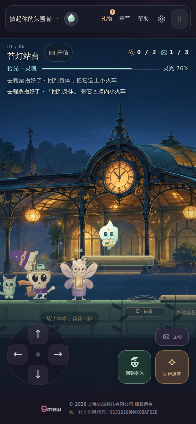

# v34 验收：近身抬盖，留一点画面

**当前状态：34.0.0正式候选准备，本地当前版本验证通过；正式候选完整CI、34部署及34真实HTTPS均未完成。** 官网保持33.0.0；33 main [40988381550](https://github.com/zhangshuaibo1/tougaigu/actions/runs/40988381550)的完整候选于2026-10-30 02:06:27 UTC成功，真实HTTPS于02:19:36 UTC成功，原产物独立审计也已通过，60文件最终证据已准确继承于 [v33完整归档](v33-main-release/README.md)。下面的34本地结果不能提前写成34上线。

## 改动与准确接续

基底为main `be05769a99a807f9396c03084760f8283ce4195e`，完整保留32最终公网归档与33已验候选、部署记录。只应用冻结v34研究的8项源码变化，然后将package与三HTML统一34.0.0：新增纯几何取景模块、base相机视图接入、三HTML、新浏览器helper、完整smoke末尾9行hook和11项新测试；升版后共9项源码变化。145运行文件、260个受保护源码／验证文件。

`dream-cap-framing.js`只为普通六章、≤480 CSS px和真实开盖阶段计算取景。使用原姿态与实际presentedSoul对象，合并身体、头、盖帽、手和拾光的保守实体横向包围；11种帽饰及无帽根据原绘制路径覆盖。发光、粒子和牵引线不作为实体轮廓。

在世界范围内求可行camera区间，稳定近身目标约8 CSS px；身体中心在视口[0,W]、几何余量足够且可行区间非空时进入，24／8 CSS px余量滞回控制进入／退出。原固定步跟随照常执行，其衰减预算每次绘制最多消费一次，在背景、世界剔除、角色和导航之前产生同一个最终camera。没有将人物单独移位，也没有绘制后恢复旧camera。远处拾光无法同时容纳、身体真正离屏、桌面和活动场景继续原跟随。

原5.5跟随系数、物理、碰撞、能量、存档、奖励与输入保持。平滑过渡需要时间，因此不保证全部移动过渡帧已经达到8px；暂停无resize时冻结，resize首帧统一投影校正，减少动态即时。重复render、重入与异常不会重复消费旧预算；v33同帧拾光作用域继续保留。

## 当前34.0.0的实际本地执行

本次2026-10-30 01:58:48.963 UTC启动，三个实际验证命令均exit0，原日志、执行器、报告与只读核验记录见 [当前版本归档](v34-formal-candidate/local-34/manifest.json)。

| 验证 | 本次实际结果 |
| --- | --- |
| `npm test` | 702项案例，702通过；失败／跳过／取消／todo均0；8.142秒 |
| `npm run check` | 70个JS模块、173项本地引用、238个34.0.0版本引用；2.192秒 |
| 专项浏览器 | helper 61.851秒，外层浏览器进程63.453秒；1280×800键盘、390×844和320×680 Chromium模拟触摸，3/3通过 |
| 页面与网络 | 三配置page／HTTP／request错误均0；首屏实际版本均34.0.0 |
| 原行为 | 开盖各阶段、近远往返、归位、暂停Canvas冻结、暂停resize首帧、反转、两朝向、游戏内减少动态及活动取景优先通过 |
| 路线范围 | 正常方向输入与现有控件；0死亡，只拿首张票，未完成章节、未产生章节结算 |
| 源码身份 | 260受保护文件执行前、执行后与独立核验时逐SHA-256完全相等；报告记录的77份源码也精确一致 |
| 原始证据 | 报告28,077,314字节；51张原PNG清单，6张原尺寸选图与无损gzip保留 |

报告SHA-256为 `e7c68786167bcf1a8acb9cb45ef83b6a5119276fa2a51412ddef61b236d2ee04`。本次标准测试输出明确计数702案例；不能借用预研另一次输出的78文件容器数量。

[320px当前34原图](v34-formal-candidate/local-34/png/320/near-open-page.png) · [暂停resize首帧](v34-formal-candidate/local-34/png/320/paused-resize-first.png) · [左朝向原Canvas](v34-formal-candidate/local-34/png/390/left-facing-open-canvas.png)。整页截图晚于几何读取，不把它们宣称为同一帧。

### 外层汇总错误完整保留

三个验证命令成功后，外层执行器误读不存在的`browser/report.json`，产生FileNotFoundError。真实helper的CLI已经返回`details: cap-framing/report.json`，报告使用`expectedVersion`字段；原`execution.json`仍保留failed和确切异常，执行器原字节也归档，没有改写成成功日志。

第一次只读核验又错误地按TAP的`# pass`解析本次Unicode `ℹ`输出，产生KeyError。最终只读核验按实际CLI返回的路径、实际字段和本次输出格式，验证报告SHA、版本、三配置、全部260源码和702案例，结果保存在`review.json`。没有为这些汇总错误重跑验证、回写原报告、改源码或改时间。这是执行器后处理与报告解析问题，不是游戏、测试命令或浏览器案例失败。

## 33.0.0预研与独立检查：单独归属

冻结研究共144文件35,593,255字节，已逐原字节转存 [v34-prestudy](v34-prestudy/README.md)；[转存校验](v34-formal-candidate/prestudy-transfer-check.json)记录来源与hash。研究源码与归档提交仅在本地，不伪造可访问的远端提交链接。

- 原691案例与77测试文件及布局fixture保留；新增11案例。完整smoke仅末尾新增9行`>=34`hook，剥除后AST与旧版本相同；先运行全部旧路线、v32对白、v33小猫，再运行本轮专项。
- 独立离线使用原绘制路径扫描1,124次，其中已包含324次拾光绘制；覆盖11帽饰和无帽、两朝向、5开度与4姿态，实体像素没有越出保守包围。这不是实体设备或浏览器全服饰证据。
- 在真正发生镜头纠偏时，新旧引擎1,376次physics／getSnapshot／events比较完全相等。另有六章短路线4,812次原路径回退比较；后者camera差为0，不能冒充实际纠偏或完整通章证据。
- 研究最终浏览器63.822秒、三配置、52原PNG，产品仍33.0.0。当前正式34另有上面的61.851秒和51原PNG；两个结果、脚本与报告各自保持原身份。

### 两次真实预研浏览器失败及修复

首次固定等待1000ms后帽沿保守留边为6.67284 CSS px，尚未达到7.5检查线；原跟随继续13步后达到7.61971。独立衰减预测误差约3.55e−15，说明镜头仍按原速度收敛。只将新增观察改为最多3000ms的有界实际几何等待，没有调高相机速度或放宽留边阈值。

之后这条严格等待暴露真实产品问题：身体中心已经在屏内，但旧18 world单位内缩条件仍拒绝重新进入近身取景，等待无法解决。将入口改为身体中心位于[0,W]，仍要求可行区间、足够几何空间及正确场景；真正离屏时保留原跟随。两个回归案例先对旧实现失败、再对修复通过；独立8条回近路线也通过。原失败报告、驱动、图像、旧源码与红绿日志完整保留，未通过改路线躲避边界。

更早的离线初版曾把可移动camera区间宽度误作画面余量，已在研究中纠正为合并轮廓后的实际剩余空间；另两次测试夹具调整与原因也在原研究记录中。它们不被抹去，也不借用作本次正式候选或公网结果。

## 正式验证待完成与限制

当前34仅完成本地逻辑、资源和定向浏览器。下一步必须取得准确候选的完整CI与原artifact审计；之后保留最新main历史，精确发布运行树与CNAME，再完成34真实HTTPS同一整套流程。33 main完整公网已经闭环；本轮正式候选与部署仍需按顺序完成。

无实体手机、Safari、低端GPU或FPS测量；未对所有服饰／所有可选活动做浏览器全组合。离线绘制、首站定向操作与完整六章流程分别记账。新增取景不处理顶部首票重复提示；那是下一轮独立设计，不能写成本轮已实现。
