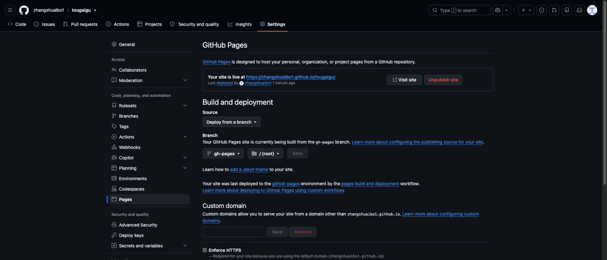

# v1.0.0 验收记录

日期：2026-10-28。

## 自动验证

JavaScript 语法检查覆盖 app、engine 与 content。两份测试覆盖 20 个逻辑场景，包括：

- 随机种子可重复、不同种子不同；装饰效果的随机数不改变战斗。
- 升级选项不重复、不超过上限，一次选择只生效一次。
- 每日模式忽略永久强化；永久强化五项数值与界面文案一致。
- 暂停后不推进时间，超长帧不会瞬移；受击无敌避免同帧连续伤害。
- 第三位首领死亡只结算一次；无尽模式不会提前结束。
- 掉落数量受限，合并不会丢失已生成的经验。
- 初始存档相互独立、购买不产生负余额、满级不扣款。
- 不重复领取成就与同局奖励；不足 15 秒不获得成长奖励。
- 导入损坏数据、超大值、未知字段或原型污染数据时进行拒绝或白名单净化。
- 禁用存储/配额不足不导致游戏崩溃，历史与每日纪录数量有界。

## 实际浏览器验证

- 桌面首页、角色选择、成长商店、三选一升级弹窗和战斗 HUD 正常显示。
- 实际使用 WASD 移动、空格冲刺、拾取经验并触发升级。
- 用数字 1 选择“手速超度”后，HUD 显示 2 级和对应技能。
- 暂停后主动结算一局：生存 35 秒、击败 24 个敌人、453 分、获得 42 骨片（含首次成就）。
- 使用真实获得的骨片购买 40 骨片的生命强化，刷新页面后新一局显示 118 / 118 生命。
- 切换每日试炼后显示 110 / 110 生命，验证永久加成被正确排除。
- 390px iframe 窄屏检查：修复 3px 横向溢出，修复封面角色画布纵横比；实际按住摇杆移动、点击冲刺，冷却正常。
- 普通经验掉落改为更醒目的约 5px 菱形和轻微光晕。
- 检查浏览器日志未发现本项目产生的脚本错误；浏览器扩展自身的元数据日志与游戏无关。

手机验收使用浏览器中 390px 宽的真实 iframe 视口，不等同于 iOS Safari / Android 真机测试。尚未开展大规模设备兼容性、长期留存或全组合平衡测试。

## 发布验收

- 静态检查确认 HTML 样式、脚本、图标和 JavaScript 模块引用均为相对路径，支持 GitHub Pages `/tougaigu/` 子路径。
- 仓库已公开；GitHub Pages 设置页显示站点已上线，发布源为 `gh-pages` 分支的 `/ (root)`，已勾选 Enforce HTTPS。
- [发布工作流](https://github.com/zhangshuaibo1/tougaigu/actions/runs/40692972037) 结果为成功，部署提交为 `4115504a2f147a827157d6b444372762bd1a5241`；其游戏源码对应 `95f5239356edf4364c9c78c72deedfd8a2f68f16`。
- 在真实线上地址 <https://zhangshuaibo1.github.io/tougaigu/> 打开首页、启动墓园冒险，确认战斗与怪潮正常推进。
- 实际触发冲刺，界面显示 3.6 秒剩余冷却。
- 收集经验进入 2 级，选择升级后显示“手速超度”1 级；继续战斗后进入 3 级升级选择。
- 检查线上浏览器日志，未发现错误或警告。

线上检查覆盖首页、进入战斗、冲刺和升级流程；结算、永久强化存档和每日模式的数值验证来自前述本地浏览器验收，未将它们重复记作线上验收。自定义域名仍未绑定。

## 内容与功能边界

这是一版可玩、可继续扩展的单人游戏。存档和成绩在本地，正在进行的单局不跨刷新恢复。界面不宣称存在服务器排名、账号同步、在线玩家人数或已绑定的自定义域名。
