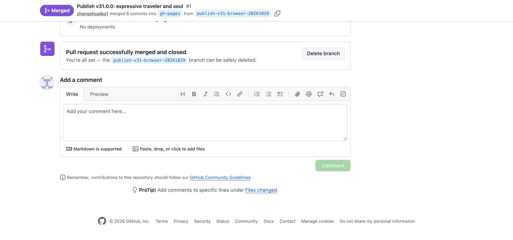

# v31 发布完成记录

**v31「眼窝里的笑」已部署到 https://tougaigu.com/，主源码同步、正式候选与完整 HTTPS 流程均已通过。** 本目录记录这一轮完成时的状态；后续版本以仓库首页和最新在途登记为准。

## 已完成的发布与验收

| 项目 | 实际结果 |
|---|---|
| 正式候选 | `7ba7c5e00a6a32032e5becf5131a527322d03ac3`；[40965474140](https://github.com/zhangshuaibo1/tougaigu/actions/runs/40965474140) 成功 |
| Pages 发布 | [PR #1](https://github.com/zhangshuaibo1/tougaigu/pull/1) 合并为 `6e716a8c40e5ad0b917f3b3e85fe86f7b09a9241`；[40975633681](https://github.com/zhangshuaibo1/tougaigu/actions/runs/40975633681) 成功 |
| 主源码同步 | [PR #2](https://github.com/zhangshuaibo1/tougaigu/pull/2) 于 2026-10-30 00:16:11 UTC 合并为 `75010ca44245e05cf44187768722081d244f39f4` |
| main 完整流程 | [40978620156](https://github.com/zhangshuaibo1/tougaigu/actions/runs/40978620156) 成功；候选 00:17:33—00:29:21 UTC，正式 HTTPS 00:29:21—00:41:05 UTC |
| 独立源包审计 | 797 个源码文件、路径、模式、blob 全部匹配 main；143 个运行文件与 Pages 精确一致，另保留空 `.nojekyll` |
| 逻辑测试 | 官方 675 / 675，失败、跳过、取消均为 0 |
| 网络与资源 | 候选及公网各三个视口，无页面或 HTTP 错误；既有故意请求失败清单精确为 9 / 0 / 0，无额外忽略 |

完整原始报告和实际图审见 [main 完整验收归档](../v31-main-release/README.md)。早期正式候选的原报告、原图和独立审计见 [候选归档](../v31-formal-candidate/README.md)。

## 发布通道的准确历史

此前 Browser 已完成 Pages 的 PR #1 发布，并把源码 PR #2 整理到无冲突状态。新的执行上下文随后缺少 originating browser context；这没有改变用户已经给出的发布授权。

第一次原生合并请求在 20 秒内没有回执，保留为当时的未知结果。刷新实际 refs 与 PR 状态后，第二次有界调用在 00:16:11 UTC 收到明确合并成功回执，随后 main 完整工作流成功。原生 GitHub 通道已经恢复，不再把历史 Browser 上下文不可用当作当前阻塞。

[00:02:16 附近的原接续快照](initial-checkpoint/README.md) 和其全部原始文件保持字节不变。该快照中的“PR #2 待合并”等文字是历史观测，不覆盖本页已确认的完成结果。

## 保留的本地环境失败

此前本地 Chromium 对正式 HTTPS 的尝试在首次导航返回 `ERR_CERT_AUTHORITY_INVALID`，尚未进入游戏；系统默认 TLS 校验同域成功。该失败与诊断完整保留在 `initial-checkpoint/local-https-environment/`，没有把它计入通过结果，也没有据此宣称产品或域名故障。未修改证书信任、关闭 HTTPS 校验或绕过代理。后来真正通过的公网证据来自上述 GitHub 官方工作流。

## 已知边界

320px 抬盖配件左缘仍有局部裁切，保留为后续视觉改进项。这里的手机验收是 Chromium 模拟触摸，未声称实体手机、Safari、低端 GPU 或 FPS 基准已经完成。
