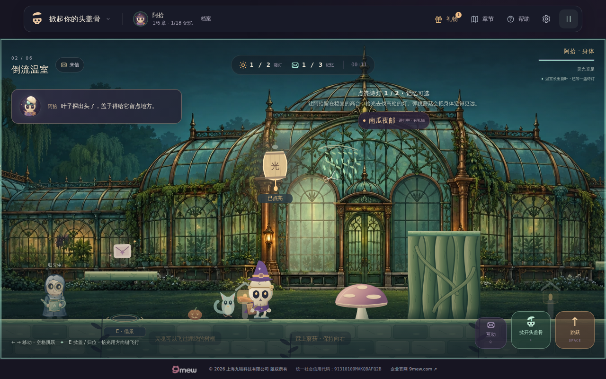
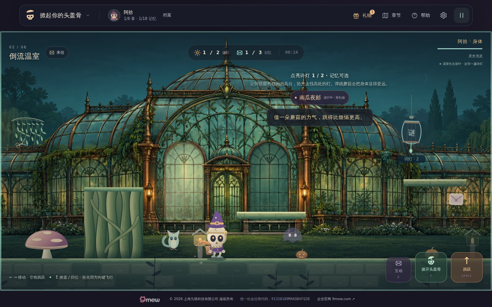

# v32 温室对白采样修正：本地定向结果

本目录保留第二候选准备时的一次本地定向验证。**新增 v32 严格采样从不稳定的根台落地点移到自然归位窗口；原落地点仍保留真实观察。** 产品的 143 个运行文件与首次正式候选 `a892471e6a4f87f534bb16434b4b9097bba10223` 逐文件 Git blob 一致，修正没有改变游戏画面代码、对白寿命、物理、存档或奖励。

## 实际执行范围与结果

- 正常键盘操作完成首章、解锁温室；随后执行现有 `exercise_greenhouse`，保留其全部原截图及完整种子、归位暂停、生长、错误答案、两盏灯、蘑菇、根台、平台和零死亡断言。
- 没有做存档注入、传送或直接引擎调用。此次首章部分仅承担正常解锁，不包含完整脚本的表情、头像迟到与疲劳检查；后续六章／手机／终章／网络全套由新正式候选另行执行。
- `targeted-report.json` 结果 `passed`；页面错误 0，请求失败 0，温室完成且没有重生。归位前与后身体均位于 `x=601, y=560`，同一个 run／章节、同死亡数。
- `npm test` exit 0：本机输出为 **76 个测试文件通过，0 失败**。`npm run check` exit 0：68 个 JS 模块、171 个本地引用、232 个 32.0.0 资源版本引用通过。

## 自然对白的准确时间与可见性

被动监听到唯一一次 `isTrusted=true`、非重复 E。该输入到达时旧对白年龄为 **1713.7ms**，满足产品现有的 1600ms 防打断条件；`lastCapBubbleAt` 随后真实更新，观察器在 finally 中移除。

闭盖事件校验读取时，新对白年龄为 **746.6ms**。稍后的严格 DOM／rig 同步快照年龄为 **766.2ms**；这是两次不同的读取，不能写成同一时刻。严格快照中原叶子句自然可见，完整文本、字体、头像、面部／帽盖／衣服／脚投影避让与 Canvas／控制区域比较均通过。

此图是对应几何读取之后的原始 1280×800 截图，不声称图与 JSON 同帧。画面中左侧对白可读，阿拾位于地面，面部、身体与脚边没有被卡片遮挡。

根台落地时，身体到达 `x=1221, y=560`，实际对白年龄已为 **4014.3ms**。它已按正常寿命自然隐藏；记录诚实保留 `bubbleObserved=false`、`actorAvoidanceChecked=false`。此时 HUD／目标／检查点公告与 Canvas、控制区域仍通过各自检查，不能把该帧说成“对白遮挡检查通过”。若其他执行的落点仍有可见对白，原验证函数仍会严格检查该气泡与真实角色投影的关系。

## 保留的物理与验证边界

本次观察到蘑菇供应的向上速度 `vy=-805`，身体从实体根台上方经过，并落在根台右侧。后续原平台路线、两盏灯与温室出口全部完成，死亡数为 0。严格对白采样的移动没有放宽这些既有路线门槛。

新增的证据校验测试会拒绝早于冷却的 E、伪造的非可信输入、未刷新的旧对白时刻、变化的身体坐标、不可见对白，以及未清理的观察器。它们是离线证据校验用例，不是额外浏览器场景。

本地结果不替代新候选的完整官方浏览器，也不替代正式 32.0.0 HTTPS 回归。首轮官方失败、精确原 JSON、root 源包核对，以及含明确省略截图标注的时序因果诊断完整保留于 [first-failure](../first-failure/README.md)。所有原文件、校验结果与源文件哈希见 [evidence-manifest.json](evidence-manifest.json)。
